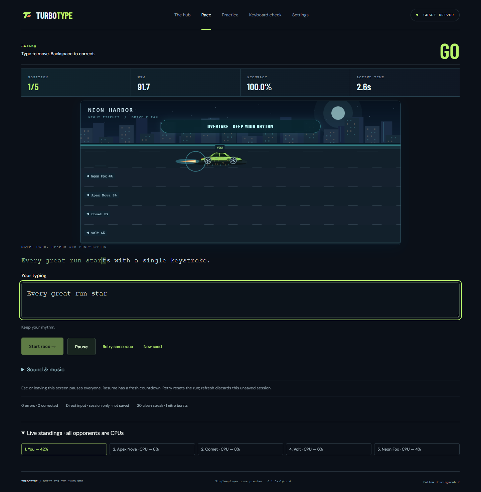

<div align="center">

# TurboType

### Build your rhythm. Find your speed. Race the road ahead.

A browser-based typing racer where every correct character moves your car forward.
Race four computer opponents while practicing speed, accuracy and clean corrections.

[](https://github.com/sahilshah2904/TurboType/actions/workflows/checks.yml)

[Get started](#get-started) · [How to play](#how-to-play) · [Project structure](#project-structure) · [Roadmap](#roadmap) · [Documentation](#documentation)

</div>



*Actual Phase 5 development preview from `feat/race-polish`. The polished art and audio are awaiting device acceptance in [PR #4](https://github.com/sahilshah2904/TurboType/pull/4).*

## What is TurboType?

TurboType turns typing practice into a side-view motor race. Your car advances as you type a passage correctly, while four computer opponents compete at a selected pace. Make a mistake, correct it with Backspace, and build your rhythm again. The goal is to make practice enjoyable while giving clear feedback on speed, accuracy and consistency.

The project is being built in documented stages: a responsive single-player game first, followed by campaign progression, optional cloud saves and friends multiplayer. Original vehicles, scenery and synthesized music give the game its own identity.

> **Development status:** `main` contains the accepted Phase 4 playable race. The latest Phase 5 racing polish is on `feat/race-polish`; its code and automated checks are complete, with physical-device visual, sound and performance review pending. There is **no public GitHub Pages game link yet**. You can run either version locally.

## What you can play today

| Experience | What it offers |
| --- | --- |
| **Quick Race** | Four seeded CPU opponents, selectable pace, countdown, live standings, passage completion or a 60-second time trial, and frozen results. |
| **Typing Practice** | The same typing engine without opponents, with WPM, accuracy, active time and clean-streak feedback. |
| **Keyboard Check** | A free-editing screen for checking your physical or phone keyboard before racing. |
| **Preferences** | Saved motion, effects and text-size choices, including a reduced-motion option. |
| **Phase 5 preview** | Three modern sports-car designs, Neon Harbor scenery, a following camera, nitro/overtaking/finish effects, and optional original music with saved volume controls. |

The current passages are short exercises for validating the game. Campaign levels, stars, rewards, a garage, accounts, cloud progress and multiplayer are planned features. Campaign cards in the hub are previews.

## Get started

### 1. Install the prerequisites

Use **Node.js 24.13.0**, **npm 11** and Git. The exact Node version is recorded in [.nvmrc](.nvmrc), and the dependency graph is pinned in [package-lock.json](package-lock.json). A fresh local preview needs no account, API key, database or `.env` file.

### 2. Clone and run the latest preview

```powershell
git clone https://github.com/sahilshah2904/TurboType.git
cd TurboType
git switch feat/race-polish
npm ci
npm run dev
```

Open **[http://127.0.0.1:5173/TurboType/](http://127.0.0.1:5173/TurboType/)** and choose **Race**. Vite watches source changes while the development server runs. Press **Ctrl+C** to stop it.

To use the accepted Phase 4 baseline, stay on `main` instead of switching to the preview branch. Once Phase 5 merges, `main` will include the polished experience.

### 3. Try it on your phone or tablet

Connect the device and development computer to the same Wi-Fi network, then run:

```powershell
npm run dev -- --host 0.0.0.0
```

Open the **Network** URL printed by Vite, including `/TurboType/`. Use **`http://`** for this local server; it does not provide HTTPS. The computer's `127.0.0.1` address will not open the game from your phone. If prompted, allow the port on your private network.

For more setup details and troubleshooting, read the [setup guide](docs/SETUP.md).

## How to play

1. Choose a passage, opponent pace and race mode. A seed lets you replay the same computer-opponent schedules.
2. Select **Start race** and wait for the three-second countdown. Typing counts after **GO**.
3. Match the passage's letters, capitalization, spaces and punctuation. Correct characters move your car.
4. If you make a mistake, your progress stops while the CPUs continue. **Backspace** removes the wrong character so you can correct it. Earlier errors still count toward accuracy.
5. Complete the passage, or reach the time limit, to see your result. **Retry same race** resets the run with the same opponents; **New seed** changes their schedules.

| Control or setting | Behavior |
| --- | --- |
| **Pause / Esc** | Freezes the player and CPUs. Resume starts a fresh countdown. Leaving the race or switching browser tabs also pauses it. |
| **Sound & music** | Phase 5: select **Enable sound** to start optional audio. Master, music and effects volumes are separate; sound starts muted. |
| **Reduced motion** | Keeps essential progress visible with a stable full-course view and fewer decorative movements. |
| **Larger typing text** | Makes text easier to read; Phase 5 also wraps the passage instead of using the scrolling strip. |

**Understanding your result:** WPM uses five characters per word and active racing time. Accuracy measures correct attempts out of all character attempts; corrections do not erase mistakes. Clean streaks reward consecutive new correct characters with visual nitro, which does not artificially advance your car. Paused or detectably assisted runs are marked practice-only. Results are currently session-only; refreshing ends the run.

The [typing rules](docs/GAME_RULES.md) and [Quick Race guide](docs/QUICK_RACE.md) explain timing, correction, CPU schedules, ties and timeouts in detail.

## Built with

| Technology | Responsibility |
| --- | --- |
| **TypeScript** | Strict types, pure typing/race rules and application code. |
| **Vite** | Local development and static production builds. |
| **Phaser** | Track rendering, vehicles, camera and racing effects. |
| **Anime.js** | Interface entrances and short animated feedback. |
| **Web Audio API** | Phase 5 original synthesized music and sound effects, without audio downloads. |
| **Vitest + Playwright** | Unit tests and browser checks across desktop, phone and tablet layout profiles. |
| **GitHub Actions** | Installation, formatting, type checks, tests and production-build verification. |

The application uses HTML/CSS for readable controls and typing input, with a separate canvas for the race. Rendering and sound read game state; they do not determine typing accuracy, CPU outcomes or rewards. See the [architecture guide](docs/ARCHITECTURE.md) for ownership and cleanup boundaries.

## Project structure

The latest development preview is organized as follows. Campaign and backend folders will be added when those systems are implemented.

```text
TurboType/
├── src/
│   ├── core/            # Pure typing engine, seeded CPUs, race state and standings
│   ├── content/         # Original practice passages
│   ├── game/            # Phaser scenes, camera projection and visual feedback
│   ├── ui/              # Screens, routing, input adapter and audio controls
│   ├── audio/           # Original score, synthesis and sound lifecycle (Phase 5)
│   ├── storage/         # Validated browser-local preferences
│   ├── config/          # App, rules, save and content versions
│   ├── main.ts          # Application entry point
│   └── styles.css       # Responsive layout and visual styling
├── public/assets/       # Shipped artwork and asset notices
├── assets-source/       # Reproducible vehicle authoring scripts (Phase 5)
├── scripts/             # Isolated renderer profiling tools (Phase 5)
├── tests/browser/       # Playwright integration and layout checks
├── docs/                # Setup, rules, architecture, evidence and decisions
│   ├── adr/             # Architecture decision records
│   └── images/          # Actual application screenshots
├── .github/workflows/   # Checks-only continuous integration
├── PROJECT_STATUS.md    # Current phase, completed work and outstanding gates
├── BACKLOG.md           # Stable task IDs and future/deferred work
└── GAME_DESIGN_PLAN.md  # Product vision, planned rules and delivery plan
```

Focused unit tests live beside their source modules as `*.test.ts`; browser flows use `*.spec.ts`. Generated output such as `dist/`, dependencies and local reference recordings are excluded from Git.

## Development and verification

Install Playwright's Chromium browser once, then run the complete check:

```powershell
npx playwright install chromium
npm run check
```

| Command | Purpose |
| --- | --- |
| `npm run dev` | Start the development server on port 5173. |
| `npm run build` | Check TypeScript and build static files into `dist/`. |
| `npm run preview` | Serve the built artifact on port 4173 under `/TurboType/`. |
| `npm test` | Run unit tests. |
| `npm run test:browser` | Run browser checks against the built artifact; run `npm run build` first. |
| `npm run typecheck` | Check types without emitting files. |
| `npm run format` | Format source, tests and configuration. |
| `npm run check` | Run formatting checks, types, unit tests, build and browser tests. |

**Verified Phase 5 snapshot:** 83 unit tests and 66 Chromium browser checks pass, with successful hosted CI. Browser device profiles test layouts and interactions; they do not certify real phone keyboards, audible mix quality or hardware frame rates. ASUS/Samsung Phase 5 acceptance remains open. Read the [verification evidence](https://github.com/sahilshah2904/TurboType/blob/feat/race-polish/docs/TESTING.md) and [device checklist](https://github.com/sahilshah2904/TurboType/blob/feat/race-polish/docs/PHASE5_POLISH_TESTS.md).

On the Phase 5 branch, `node assets-source/build-vehicles.mjs` recreates all three car bodies. The original music is authored directly in source. [Asset provenance](https://github.com/sahilshah2904/TurboType/blob/feat/race-polish/docs/ASSETS.md), [audio recreation](https://github.com/sahilshah2904/TurboType/blob/feat/race-polish/docs/AUDIO.md) and [renderer profiling](https://github.com/sahilshah2904/TurboType/blob/feat/race-polish/docs/PERFORMANCE.md) document how to reproduce them.

## Roadmap

| Phase | Deliverable | Current status |
| --- | --- | --- |
| 1–4 | Design, app foundation, typing engine and playable four-CPU race | Complete for the agreed scopes; broader release coverage remains tracked. |
| 5 | Racing art, animation, original audio and performance work | Implemented on the preview branch; device acceptance pending. |
| 6 | Cinematic opening, loading flow, rules and interactive onboarding | Planned. |
| 7 | Easy, Medium and Hard campaign maps with numbered circular nodes | Planned. |
| 8 | 100 levels per category: **300 main levels**, plus chapter/bonus challenges | Planned. |
| 9 | Rewards, garage, learning feedback, guest saves and optional account-backed cloud progress | Planned before public single-player launch. |
| 10 | Cross-device verification and public single-player launch on GitHub Pages | Planned. |
| 11 | Friends multiplayer with shareable invites, lobbies and synchronized racing | Planned immediately after single-player launch. |

Campaign maps will progress horizontally, with locked stages opening as you clear each level. Planned rewards, bonus events and learning feedback are defined in the design documents; they are not active in the preview.

[Project status](https://github.com/sahilshah2904/TurboType/blob/feat/race-polish/PROJECT_STATUS.md) tracks the latest phase evidence. The [backlog](https://github.com/sahilshah2904/TurboType/blob/feat/race-polish/BACKLOG.md) preserves future tasks so deferred work is not lost.

## Saves, hosting and multiplayer

Today, browser storage remembers preferences. Race text/results live only in memory; there is no account, database, saved campaign progress or multiplayer service yet.

GitHub Pages is the planned host for the static game. A separate backend will provide optional account-backed progress and later realtime multiplayer. The [responsive and online architecture](docs/RESPONSIVE_AND_ONLINE_ARCHITECTURE.md) records those boundaries; a provider project has not been provisioned.

Saving a local file updates your development preview. **Commit and push** publish source changes to GitHub. A future Pages deployment workflow will publish the playable website separately; the current workflow only checks the project.

## Documentation

| Start here if you want to… | Read |
| --- | --- |
| Set up, build or troubleshoot the project | [Setup guide](docs/SETUP.md) |
| Understand implemented gameplay and correction | [Game rules](docs/GAME_RULES.md) · [Quick Race](docs/QUICK_RACE.md) |
| Navigate the code and its boundaries | [Architecture](docs/ARCHITECTURE.md) · [Decision records](docs/adr) |
| Understand the art, sound and performance direction | [Art bible](https://github.com/sahilshah2904/TurboType/blob/feat/race-polish/docs/ART_BIBLE.md) · [Audio](https://github.com/sahilshah2904/TurboType/blob/feat/race-polish/docs/AUDIO.md) · [Performance](https://github.com/sahilshah2904/TurboType/blob/feat/race-polish/docs/PERFORMANCE.md) |
| Follow the product plan and future work | [Game design](GAME_DESIGN_PLAN.md) · [Latest status](https://github.com/sahilshah2904/TurboType/blob/feat/race-polish/PROJECT_STATUS.md) · [Backlog](https://github.com/sahilshah2904/TurboType/blob/feat/race-polish/BACKLOG.md) |
| Reproduce checks or understand coverage limits | [Latest test evidence](https://github.com/sahilshah2904/TurboType/blob/feat/race-polish/docs/TESTING.md) |
| Follow naming, versioning and Git practices | [Engineering conventions](docs/ENGINEERING_CONVENTIONS.md) · [GitHub workflow](docs/GITHUB_WORKFLOW.md) |
| Review research and future data rules | [Implementation research](IMPLEMENTATION_RESEARCH.md) · [Rules/storage baseline](docs/RULES_AND_STORAGE_BASELINE.md) |

## Feedback and contributions

Found a bug or have an idea? [Open an issue](https://github.com/sahilshah2904/TurboType/issues). Include the branch/version, device, browser, steps to reproduce, and what you expected. Screenshots help with layout; a short recording helps with motion or sound problems.

For code changes, follow the engineering conventions, use a focused branch, update the relevant documentation and run the checks before opening a pull request. Keep future proposals distinct from implemented behavior. Use short, meaningful plain-English commit messages.

Created by **Sahilshah**. Vehicle artwork and synthesized music in the Phase 5 preview are original project assets; fonts retain their license notices. User reference recordings and their soundtrack are not shipped. A project-wide license has not yet been selected.
