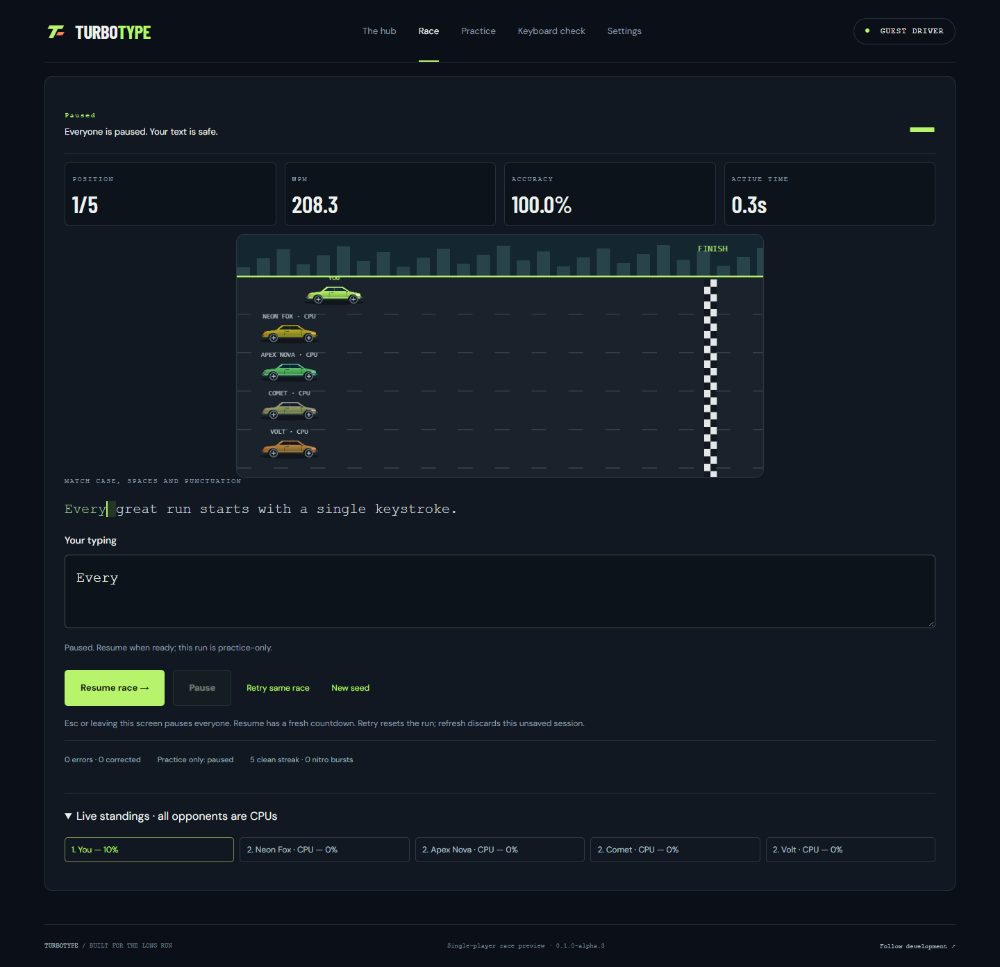

# TurboType

An immersive typing racer: race computer opponents, improve accuracy and speed, and advance through Easy, Medium, and Hard campaigns with 100 levels each.

**Status:** Phase 4 Quick Race implemented on `feat/solo-race`: four seeded CPUs, live track/standings, finish/results and retry. Phase 2/3 are merged into main. Local formatting/types/build, 69 unit tests and 54 browser tests pass. Phase 4 available-device acceptance remains TT-404. Broader physical iPhone/tablet coverage remains a release gate. Campaigns, modern art/audio, persistent rewards and public deployment are future work. See TESTING.md through the documentation links below. Source repository: [sahilshah2904/TurboType](https://github.com/sahilshah2904/TurboType).

## Run the preview

Use Node 24.13.0 and npm 11. From `feat/solo-race`:

```powershell
npm ci
npm run dev
```

Open **http://127.0.0.1:5173/TurboType/**. Select **Race** for the first complete single-player race. Choose a passage, CPU pace, untimed completion or a 60-second trial; use a seed to repeat opponent schedules. **Practice** remains available without opponents. Countdown, correction, pause/resume and frozen metrics use the same typing engine. The hub also includes an animated Phaser track, a free-editing keyboard check and saved preferences. Campaign cards remain previews; rewards, accounts, cloud saves and multiplayer are not available.

To validate the production build:

```powershell
npx playwright install chromium
npm run check
```

See [setup instructions](docs/SETUP.md) and [test evidence](docs/TESTING.md) for reproduction, actual coverage and limitations.



## Planned experience

- Four-CPU single-player Quick Race is implemented; richer art/audio and campaign integration follow.
- Three horizontal campaign maps with numbered nodes, sequential unlocks, stars, and optional bonuses.
- Cinematic entrance, interactive rules/tutorial, garage, progression, and targeted practice.
- TypeScript, Vite, Phaser, and Anime.js; planned hosting on GitHub Pages.
- Responsive phone/tablet/laptop play, optional account-backed cloud progress before public single-player launch, then friends multiplayer using a separate realtime backend.

## Documentation

- [Project status and phases](PROJECT_STATUS.md) — persistent progress tracker, completed work, remaining work, and evidence requirements.
- [Future work backlog](BACKLOG.md) — phase-by-phase task checklist, deferred work, dependencies and optional ideas.
- [Setup](docs/SETUP.md), [architecture](docs/ARCHITECTURE.md), [test evidence](docs/TESTING.md), and [asset register](docs/ASSETS.md) — implemented app details and verification.
- [Quick Race implementation and recreation](docs/QUICK_RACE.md) and [Phase 4 device check](docs/PHASE4_RACE_TESTS.md) — exact CPU schedules, timing, simulated results, recovery and verification.
- [Implemented typing rules](docs/GAME_RULES.md) and [Phase 3 phone retest](docs/PHASE3_INPUT_TESTS.md) — actual correction, clock, metrics and assistance policy.
- [Game design and delivery plan](GAME_DESIGN_PLAN.md) — authoritative proposed behavior and milestone gates.
- [Rules and storage baseline](docs/RULES_AND_STORAGE_BASELINE.md) — planning audit, exact initial reward/cooldown defaults, and local-save/database boundaries.
- [Responsive and online architecture](docs/RESPONSIVE_AND_ONLINE_ARCHITECTURE.md) — phones/tablets/laptops, account-backed progress, data synchronization, and multiplayer foundations.
- [Implementation research](IMPLEMENTATION_RESEARCH.md) — library comparisons, sources, animation and deployment research.
- [Engineering conventions](docs/ENGINEERING_CONVENTIONS.md) — naming, Git workflow, versions, stable IDs, and module boundaries.
- [Reference recording analysis](docs/REFERENCE_VIDEO_ANALYSIS.md) — timestamped visual observations and the proposed original soundtrack direction.
- [GitHub workflow](docs/GITHUB_WORKFLOW.md) — linking the local folder, committing, pushing, and future deployment.

The repository now contains the app, pinned dependency lockfile, unit/browser tests, a checks-only CI workflow and implementation documentation. User reference screenshots/video remain local and excluded from Git history. Pages deployment is not configured yet.

## How changes reach GitHub

Save files → inspect and validate changes → commit → push. Git does not upload each file save. A successful push publishes the selected commits; a future Pages workflow will build and deploy eligible changes separately.

Use focused feature branches for substantial implementation work, with validation and documentation in the same change. The initial planning baseline is prepared on `main`. See the workflow guide for exact commands and safety checks.
