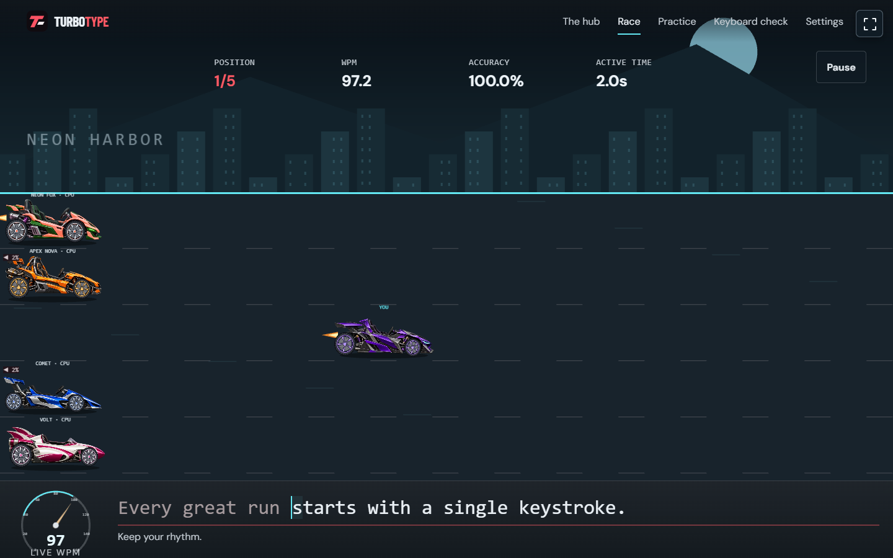
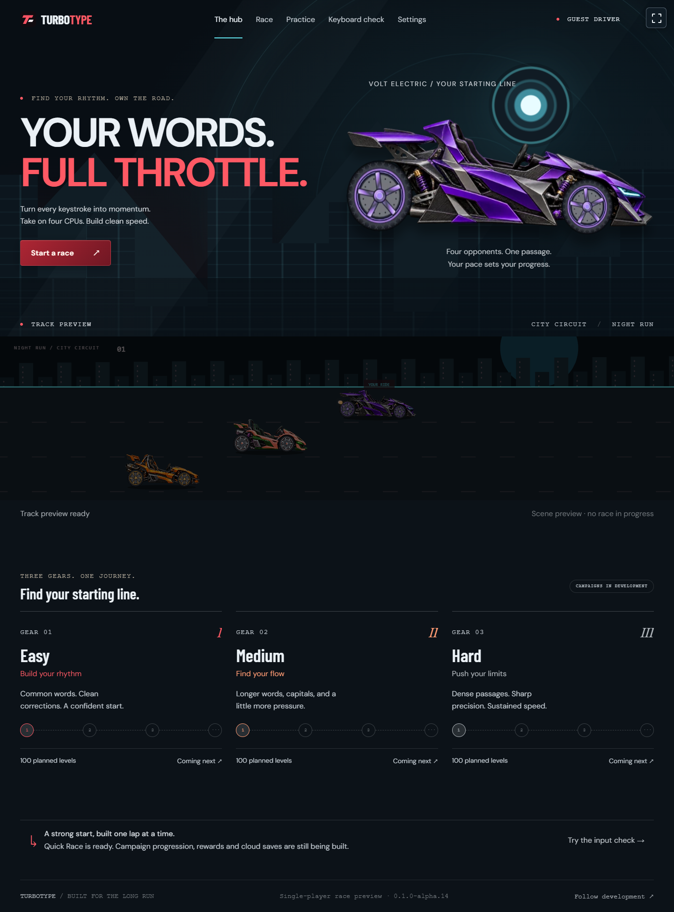

<div align="center">

# TurboType

### Your words. Full throttle.

An original browser typing racer: build physical-keyboard speed and accuracy while racing four computer opponents.

[](https://github.com/sahilshah2904/TurboType/actions/workflows/checks.yml)

[Run locally](#run-the-latest-preview) · [How to play](#how-to-play) · [Progress](#development-progress) · [Structure](#project-structure) · [Documentation](#documentation)

</div>



*Actual **0.1.0-alpha.14** gameplay, accepted and integrated into **main** through [PR #4](https://github.com/sahilshah2904/TurboType/pull/4). This is a local preview; no public game is deployed.*

## What is TurboType?

TurboType turns typing practice into a side-view motor race. Correct characters move your car; mistakes require correction while four seeded computer opponents continue. It makes practice enjoyable while showing honest speed, accuracy and consistency metrics.

The current target is **laptop/desktop browsers with a physical keyboard**. Phone/tablet support was explicitly removed. Layouts adapt to laptop windows from 960 CSS pixels, with automated checks at representative 1024–1920 widths.

Single-player comes first. Three 100-level campaigns, learning tools and optional cloud progress are planned before public launch, followed by friends multiplayer. **There is no public GitHub Pages game, account service or database yet.** You can run the latest preview locally.

## How the current game looks

The preview uses a full-window city circuit, detailed original karts, graphite/crimson/cyan lighting and one integrated typing surface. A shared fullscreen/restore icon sits at the upper-right of every page. Important prose/controls use 16px or larger text, with 14px compact labels.

<details>
<summary>View the current hub, car selector and Settings</summary>

### Clean hub with your chosen car



### Five starter cars before each race


### All audio controls in Settings


</details>

These are real app captures, not concept artwork. [Current parts/laptop captures](https://github.com/sahilshah2904/TurboType/tree/main/docs/images/alpha14) include all five starter models and 1024–1920px race layouts. Earlier screenshots remain historical evidence.

## What you can play now

| Experience | Implemented behavior |
| --- | --- |
| Quick Race | Four seeded CPUs, countdown, selectable passage/pace, live positions, completion or a 60-second trial, frozen results and same-seed retry |
| Car choice | Five original starters, remembered in this browser and reflected in the hub. One chosen car stays locked from countdown through the whole race, including pauses; retry/new race reopens selection |
| Typing Practice | Shared engine without opponents; WPM, accuracy, streaks, timing, correction, pause and results |
| Keyboard check | Free-editing physical-keyboard diagnostic, expected-key assistance and reset |
| Racing presentation | Parallax city, exhaust flames, nitro/overtake feedback, bounded finish effects, Live WPM dial and High/Low/Reduced modes |
| Settings | Saved display/text/motion preferences and all sound enable/mute/volume controls. Original Ignition browsing music, Overdrive racing music and separate countdown/FX |
| Recovery | Graphics retry or text standings, optional audio, denied-storage notices and graceful fullscreen refusal |

The current passages are three short validation exercises, **not the 300 campaign levels**. Race/results are session-only. No XP, stars, credits, unlock ownership, records, saved campaign, accounts or multiplayer are implemented yet.

## How to play

1. Open **Race**, select a passage/CPU pace and choose a starter car before starting.
2. Press **Start race**, wait for 3–2–1/GO, then match the exact case, spaces and punctuation in the integrated strip.
3. A mistake stops your progress while CPUs continue. Use **Backspace** to correct it; accuracy retains previous attempts.
4. Use **Pause** or Escape when needed. Everyone freezes; resume has a fresh countdown. Your car cannot change mid-race. Paused runs are practice-only for future record eligibility.
5. Finish the passage or reach the selected time limit. Results freeze; later CPU outcomes are labeled simulated. Retry resets the run and permits another car choice.

The HUD shows average WPM; the **Live WPM** dial shows recent correct typing over up to three active seconds. Nitro is a visual streak reward and never adds speed/progress. All cars have identical gameplay performance.

Open **Settings → Sound & music** to enable sound or change volumes. The hub has no audio widgets. The corner icon enters/restores fullscreen when permitted. Refresh retains preferences but discards an unsaved race.

[Implemented rules](https://github.com/sahilshah2904/TurboType/blob/main/docs/GAME_RULES.md) · [Race/CPU semantics](https://github.com/sahilshah2904/TurboType/blob/main/docs/QUICK_RACE.md)

## Development progress

**Phases 1–5 are complete for their agreed scope.** Alpha.14 includes independent parts, automated/actual-GPU evidence, final physical laptop acceptance and PR integration. Broader browser/long-session release testing remains Phase 10. Existing-page visuals are partial Phase 6 work; cinematic loading/onboarding is next.

| Phase | Delivery | Current status |
| --- | --- | --- |
| 1 | Finalize design: flow, rules, rewards, visual direction and storage/online boundaries | Baseline complete; production tuning/content remain separate |
| 2 | Set up TypeScript/Vite, Phaser/Anime.js, structure, configuration and checks | Foundation complete |
| 3 | Build validation/correction, WPM/accuracy, streaks, timing, pause and finishing | Complete for agreed engine/input scope |
| 4 | Create one complete four-CPU race with countdown, placement, results and retry | Complete and merged into main |
| 5 | Polish vehicles, wheels/suspension, scenery, exhaust/nitro, sound and celebration | Complete for agreed scope; accepted and merged into main |
| 6 | Cinematic loading/welcome/rules, tutorial, calibration and final navigation | Existing pages revamped; onboarding not implemented |
| 7 | Easy/Medium/Hard rightward maps, 100 numbered nodes each, locks, chapters and saved position | Planned |
| 8 | Author/validate all 300 passages, learning goals, difficulty/star curves and bonus challenges | Planned |
| 9 | Rewards/rank/garage, records/charts/coaching/drills, robust guest saves and optional account-backed cloud progress | Planned |
| 10 | Desktop browser/accessibility/performance/recovery/cloud testing, Pages and live release verification | Planned |
| 11 | Friends backend/private rooms/invites, synchronized races, reconnect/rematches immediately after solo launch | Planned |

Phases vary greatly in size; phase numbers are not a completion percentage.

### Phase 5 completion

- **Vehicle parts:** alpha.14 implements separate chassis/wheel sources, independent rotation, chassis-only suspension and compact shared previews while preserving the accepted silhouettes/colors. See [Phase 5 closeout](docs/PHASE5_CLOSEOUT.md).
- **Physical acceptance:** the user accepted the final laptop checklist. The two-minute recorder captured 100 trusted racing keys and zero page errors; actual-GPU experiments cover High/Low/Reduced. Timing/resource limitations and broader release checks remain explicit.
- **Integration:** PR #4 merged as de464ce after exact-head checks passed. Main contains the accepted alpha.14 preview. Next is Phase 6 loading/onboarding; no deployment has occurred.

### Future category reward cars

Five starters are available now. Later, **each 100-level category (Easy, Medium, Hard) unlocks a distinct car every 15 eligible main-level clears**, at **15, 30, 45, 60, 75 and 90 within that category**. That is **18 reward cars plus five starters**. Category counters are independent; replay, bonus events, Quick Race and Practice do not inflate them. Cars remain cosmetic.

Stable IDs, art briefs, locked garage UX, receipt-based ownership, save recovery and cloud merges are in the [garage progression plan](https://github.com/sahilshah2904/TurboType/blob/main/docs/GARAGE_PROGRESSION.md), tracked **TT-911**. These cars/unlocks are future Phase 8/9 work, not a Phase 5 prerequisite.

## Run the latest preview

Use **Node.js 24.13.0**, **npm 11** and Git. Dependencies are pinned. Local solo preview needs no API key, account, database or .env file.

```powershell
git clone https://github.com/sahilshah2904/TurboType.git
cd TurboType
git switch main
npm ci
npm run dev
```

Open **[http://127.0.0.1:5173/TurboType/](http://127.0.0.1:5173/TurboType/)**. Vite updates the local preview when source changes. If reusing a checkout, inspect Git status and preserve local edits before switching branches or pulling.

```powershell
npx playwright install chromium
npm run check
```

The full check runs formatting, TypeScript, unit tests, build and browser scenarios. **npm run build** creates the static artifact; **npm run preview** previews it locally. Follow the [setup guide](https://github.com/sahilshah2904/TurboType/blob/main/docs/SETUP.md) for commands/troubleshooting.

## Verification and GitHub emails

Alpha.14 passed **96 unit tests and 36 desktop Chromium browser cases**, actual-GPU High/Low/Reduced checks and final physical laptop acceptance. The two-minute recorder captured 100 trusted racing keys with zero page errors. Exact acceptance head 398d455 passed [hosted run 39727202033](https://github.com/sahilshah2904/TurboType/actions/runs/39727202033), then PR #4 merged as de464ce. Later documentation/main heads have their own check state; the badge tracks main.

Two older runs genuinely failed when the combined garage browser test exceeded its 30-second budget while duplicate counterparts passed. The scenario is now split into focused cases without raising the timeout. Feature validation runs once per PR update, main on push, with manual dispatch and cancellation of superseded runs. Notification settings remain unchanged. [Detailed evidence/limits](https://github.com/sahilshah2904/TurboType/blob/main/docs/TESTING.md).

## Project structure

This is the latest preview branch's structure; main code remains older until integration.

```text
src/
  core/       Pure typing, metrics, CPU schedules, timing and standings
  content/    Exercise passages and stable starter-car catalog
  game/       Phaser race/preview, kart parts/anchors and visual feedback
  ui/         Routes, native input, screens, WPM gauge and fullscreen
  audio/      Optional music/effects ownership and lifecycle
  storage/    Validated local display/audio/cosmetic preferences
  config/     App, rules, save and content versions
public/assets/ Authored game art, audio and provenance-backed assets
assets-source/ Raster masters/prompts and reproducible authoring scripts
scripts/       Kart exports and isolated/full-app profiling tools
tests/browser/ End-to-end input, race, settings, graphics and recovery
docs/          Design, architecture, recreation, screenshots and handoff
Reference_Images/ Ignored user recordings/screenshots/analysis tools
```

Phaser owns the canvas; native HTML owns input/navigation; Anime.js coordinates brief interface motion. Pure rules do not depend on frame rate, sound or selected car. GitHub Actions validates source; **it does not deploy the game**.

## Saves, hosting and future multiplayer

Only display/audio/car preferences persist locally today. A future guest save model will store campaign clears, rewards and ownership with migration/recovery; optional account-backed cloud progress comes before public solo launch. A selected-car preference will not be trusted as ownership.

GitHub Pages will host the frontend. Friends rooms need external auth/data/realtime services for invites, ready checks, synchronized races and reconnection. Sharing a static URL alone does not create multiplayer. Provider choice and infrastructure are pending.

## Continue in a new project chat

Start with [AGENTS.md](https://github.com/sahilshah2904/TurboType/blob/main/AGENTS.md), the [detailed session handoff](https://github.com/sahilshah2904/TurboType/blob/main/docs/SESSION_HANDOFF.md), [project status](https://github.com/sahilshah2904/TurboType/blob/main/PROJECT_STATUS.md) and [stable backlog](https://github.com/sahilshah2904/TurboType/blob/main/BACKLOG.md). They record accepted decisions, current code/CI, completed work, pending tasks and the next steps. The previous chat is not required.

## Documentation

These links deliberately target the preview branch so the default-branch README points to current evidence.

| Purpose | Guide |
| --- | --- |
| Product and designed rule/reward/storage defaults | [Game plan](https://github.com/sahilshah2904/TurboType/blob/main/GAME_DESIGN_PLAN.md) · [Baseline](https://github.com/sahilshah2904/TurboType/blob/main/docs/RULES_AND_STORAGE_BASELINE.md) |
| Implemented behavior | [Rules](https://github.com/sahilshah2904/TurboType/blob/main/docs/GAME_RULES.md) · [Quick Race](https://github.com/sahilshah2904/TurboType/blob/main/docs/QUICK_RACE.md) |
| Architecture and conventions | [Architecture](https://github.com/sahilshah2904/TurboType/blob/main/docs/ARCHITECTURE.md) · [Engineering](https://github.com/sahilshah2904/TurboType/blob/main/docs/ENGINEERING_CONVENTIONS.md) · [GitHub workflow](https://github.com/sahilshah2904/TurboType/blob/main/docs/GITHUB_WORKFLOW.md) |
| Recreate the assets and app | [Fleet](https://github.com/sahilshah2904/TurboType/blob/main/docs/KART_FLEET.md) · [Audio](https://github.com/sahilshah2904/TurboType/blob/main/docs/AUDIO.md) · [Visual integration](https://github.com/sahilshah2904/TurboType/blob/main/docs/IMMERSIVE_APP.md) |
| Testing and measured limits | [Verification](https://github.com/sahilshah2904/TurboType/blob/main/docs/TESTING.md) · [Full-app profile](https://github.com/sahilshah2904/TurboType/blob/main/docs/PERFORMANCE_ALPHA14.md) |

Original assets/audio have tracked sources/prompts/provenance. Reel assets/music and franchise artwork are not shipped. This is a development preview, not a completed single-player release.
