# TurboType

TurboType is a free single-player typing racer for laptop and desktop browsers. Your car advances as you type, and four computer opponents keep the pressure on. Race through 300 campaign levels, unlock cars and tracks, and see how your speed and accuracy improve.

**[Play TurboType](https://sahilshah2904.github.io/TurboType/)** · [v0.1.0 release](https://github.com/sahilshah2904/TurboType/releases/tag/v0.1.0) · [Privacy policy](https://sahilshah2904.github.io/TurboType/privacy.html)

[How to play](#how-to-play) · [Game features](#game-features) · [Screenshots](#screenshots) · [How it was built](#how-it-was-built) · [Run locally](#run-locally)

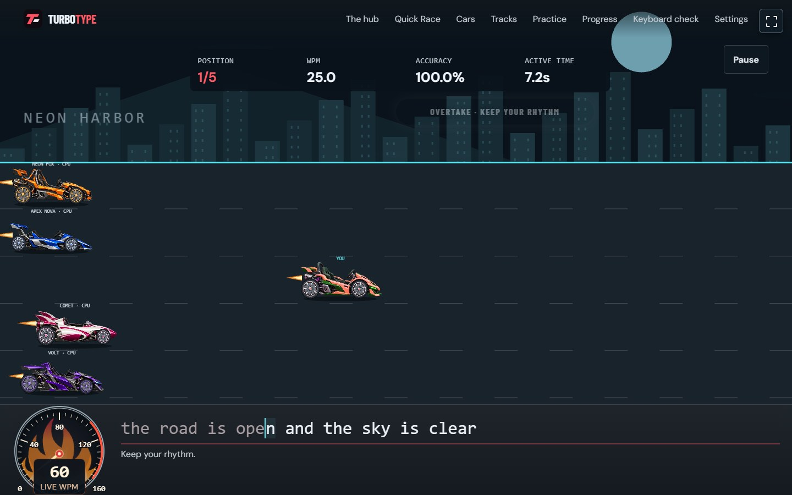

## How to play

Use a physical keyboard in a desktop browser. The game is designed for windows at least 960 CSS pixels wide.

1. **Open the game.** Watch the opening, then enter **The hub**. The guided tutorial and pace calibration are optional.
2. **Pick a race.** Choose **Easy**, **Medium**, or **Hard** on the hub for campaign play. Choose **Quick Race** for a standalone warm-up. Visit **Cars** or **Tracks** to change equipment before the countdown.
3. **Type after GO.** Match the passage exactly, including case, spaces, and punctuation. A mistake stops your car's progress while the opponents continue. Press **Backspace** to correct it.
4. **Finish the passage.** An exact, eligible campaign finish unlocks the next level in that category, regardless of where you place. Accuracy and pace can earn extra stars. Press **Escape** or use **Pause** when you need a break. A race paused after GO counts as practice.
5. **Review your result.** Check placement, words per minute, accuracy, and time. Retry the race or continue to the next level. Open **Progress** for your race history, records, and coaching.

Share the public homepage so new players start at the opening. The Progress shortcut goes straight to stats and sign-in. To watch the title sequence again, choose **Settings → Replay opening**. [Public homepage](https://sahilshah2904.github.io/TurboType/) · [Progress shortcut](https://sahilshah2904.github.io/TurboType/#/progress)

## Game features

| Feature | What you can do |
| --- | --- |
| **Campaign** | Play 100 main levels in each of Easy, Medium, and Hard. Work from short warm-ups to longer original passages. Each category has 10 chapters and 10 optional bonus challenges. |
| **Quick Race** | Pick a passage and opponent pace, race four computer drivers, and replay the same matchup. Choose a standard finish or a 60-second time trial. |
| **Cars and tracks** | Start with five cars and five tracks. Unlock 18 more cars and 21 more tracks through campaign milestones. Owned equipment works across categories, and every car follows the same racing rules. |
| **Practice and keyboard check** | Drill correction, capitalization, punctuation, or consistency without race pressure. Use the keyboard check to see which physical keys the game receives. |
| **Driver Progress** | Earn XP, rank, credits, and milestone awards. Review recent pace, comparable personal bests, accuracy, and practice suggestions. |
| **Display and audio** | Adjust motion, track effects, typing text size, and sound in Settings. Use fullscreen for more room and text standings if track artwork fails to load. |

Guest progress is saved in the current browser. **Progress → Save and backup tools** lets you export or import a JSON save. Approved Google accounts can sign in to restore their own cloud progress on another browser or device. [Save and recovery guide](docs/PHASE10_RELEASE.md#data-and-recovery)

## Screenshots

### From the opening to the finish

| Opening | The hub |
| --- | --- |
| 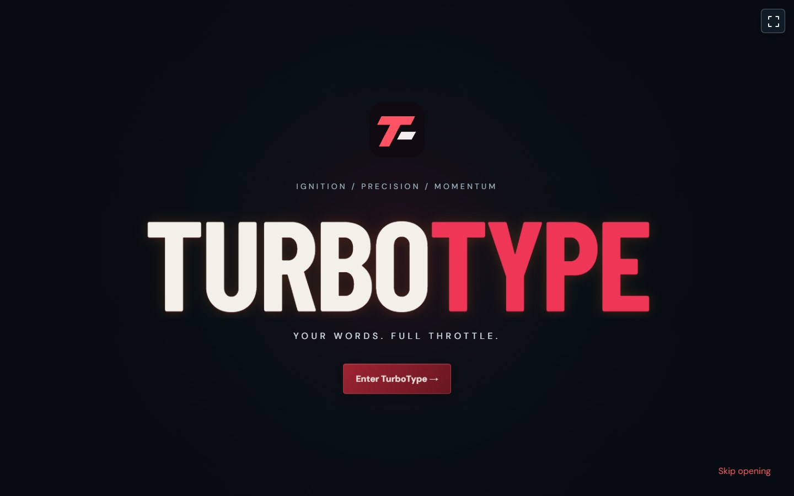 | 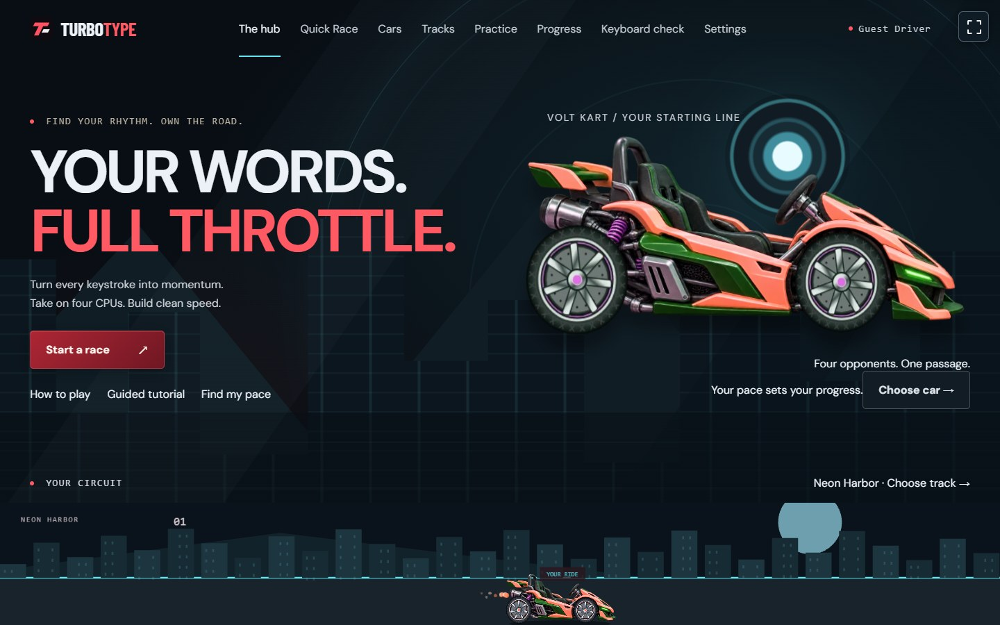 |

| Campaign map | Race briefing |
| --- | --- |
| 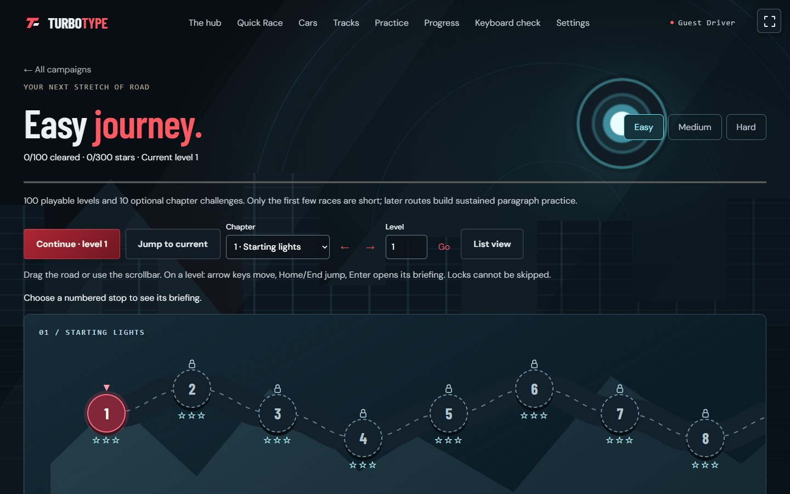 | 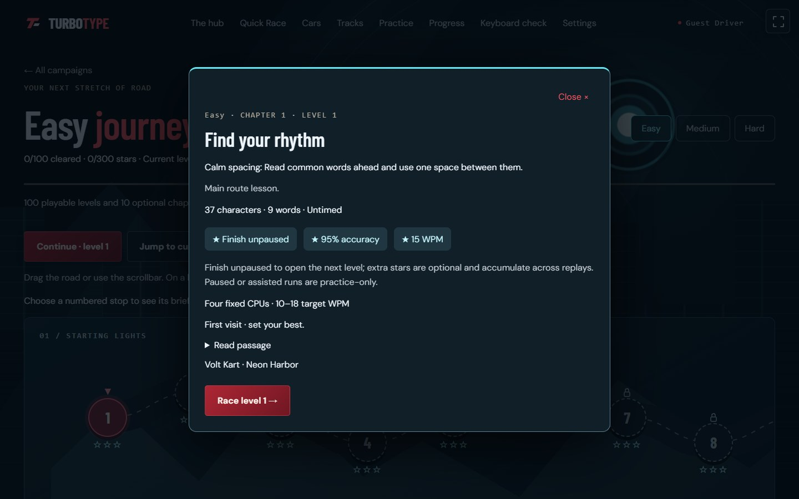 |

| Results | Driver Progress |
| --- | --- |
| 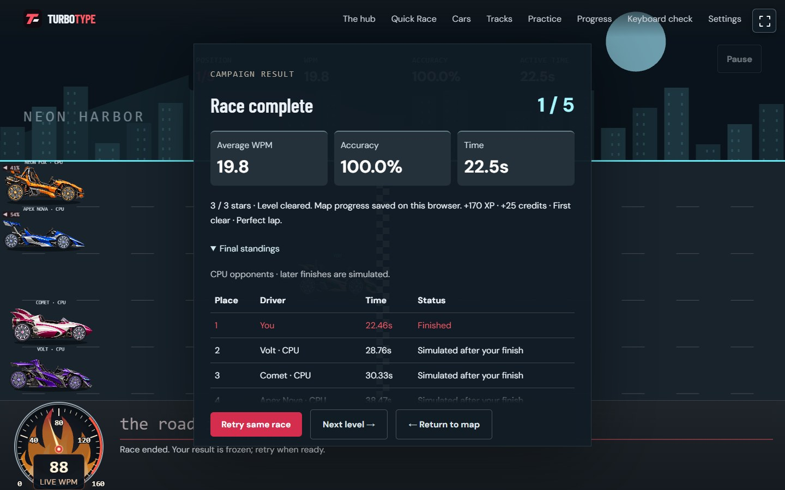 | [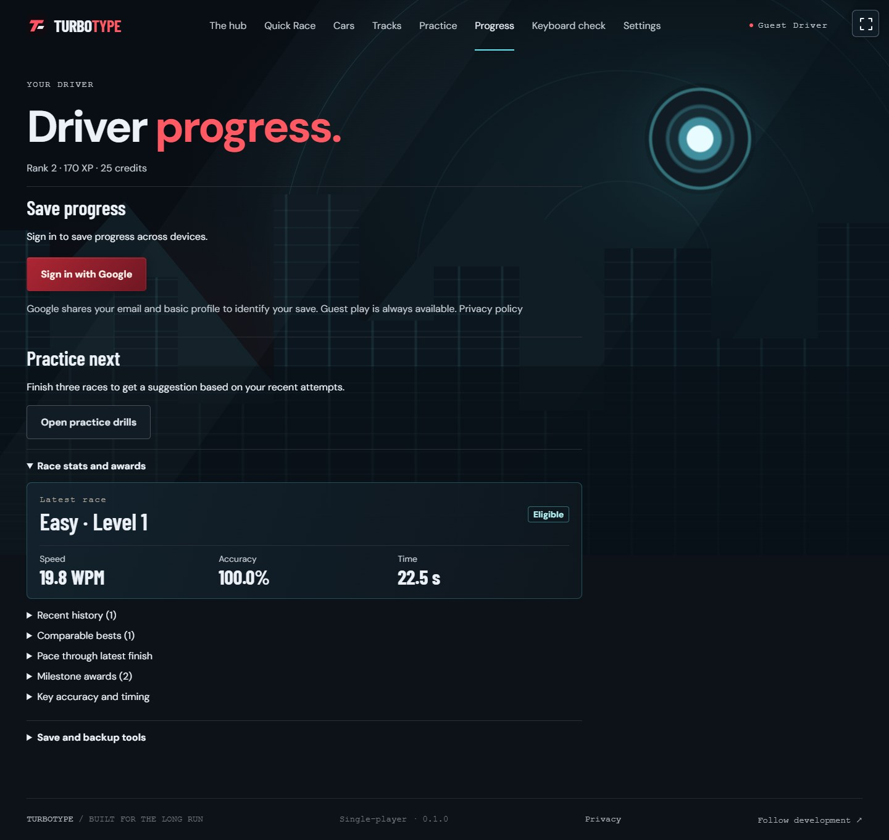](docs/images/v0.1.0/progress.jpg) |

<details>
<summary>See Cars, Tracks, Practice, Keyboard check, and Settings</summary>

| Cars | Tracks |
| --- | --- |
| 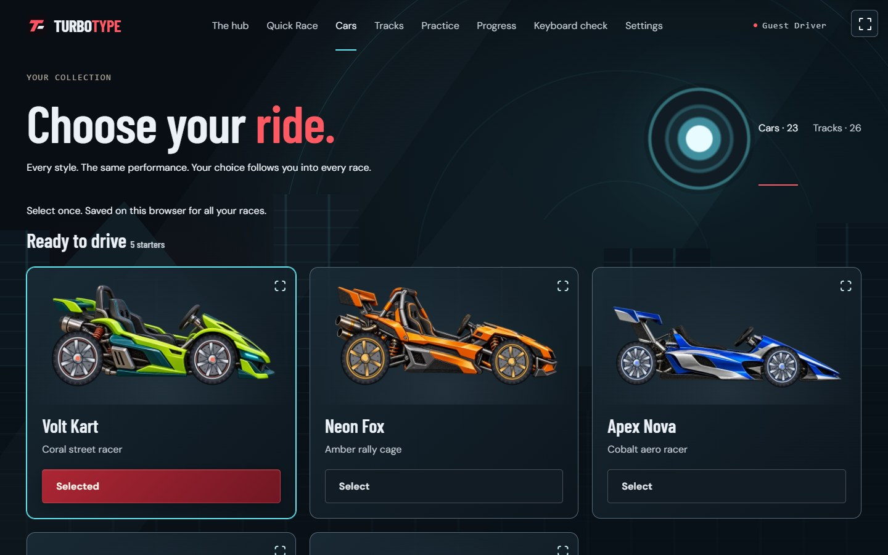 | 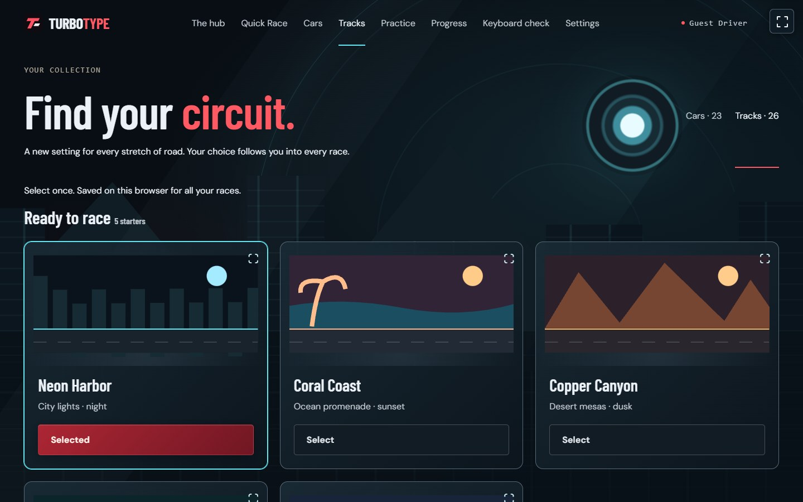 |

| Practice | Keyboard check |
| --- | --- |
| 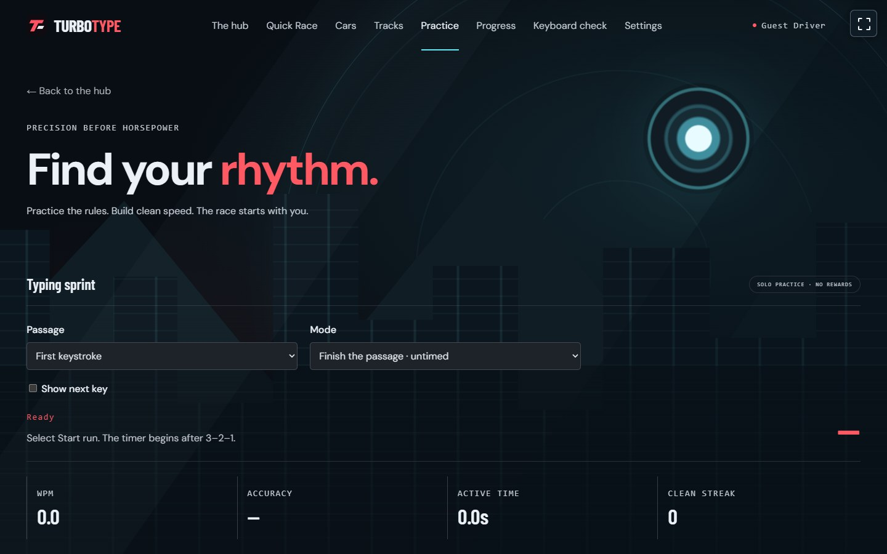 | 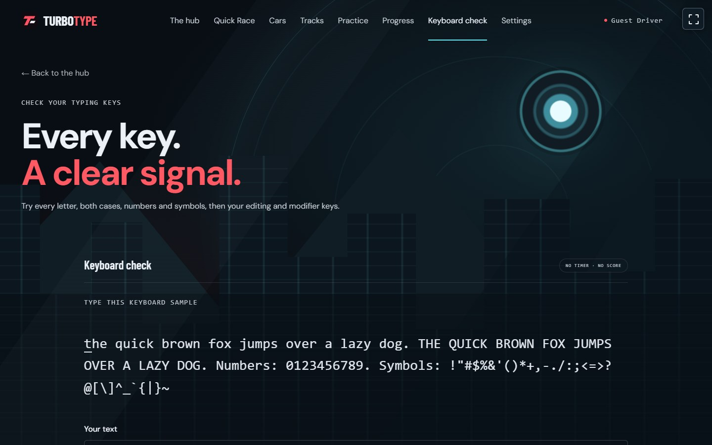 |

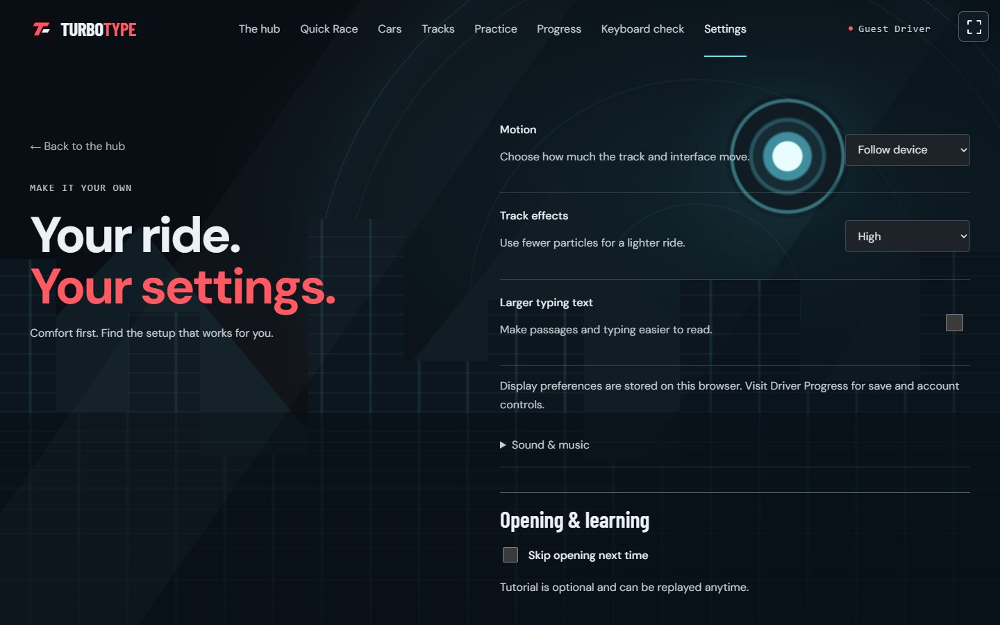

</details>

These screenshots come from the hosted v0.1.0 build. Race, results, and progress metrics use scripted typing in an isolated guest profile. [Reward car and track close-ups](docs/images/alpha27/README.md) · [Full screenshot archive](docs/images/)

## How it was built

| Area | Technology or system | What it does |
| --- | --- | --- |
| Game rules | TypeScript in [`src/core`](src/core/) | Validates typing, calculates WPM and accuracy, schedules seeded opponents, and awards campaign progress independently of graphics. |
| Browser interface | Native HTML, CSS, TypeScript, and Fontsource | Runs navigation, typing input, menus, accessible controls, and the race HUD with locally served fonts. [UI source](src/ui/) |
| Race graphics | Phaser in [`src/game`](src/game/) | Renders tracks, car sprites, camera motion, scenery layers, and racing effects. |
| Interface animation | Anime.js | Handles screen transitions and interface motion. |
| Music and effects | Web Audio API in [`src/audio`](src/audio/) | Plays the original soundtrack and countdown, race, and finish cues with optional sound controls. |
| Campaign and artwork | Authored catalogs, SVG and WebP assets | Supplies original passages, difficulty curves, vehicle parts, and course art. [Content source](src/content/) · [Asset provenance](docs/ASSETS.md) |
| Local saves | Web Storage and versioned JSON in [`src/storage`](src/storage/) | Keeps guest progress and preferences in the browser, with migration and backup tools. |
| Sign-in and cloud saves | Supabase Auth, Google OAuth, PostgreSQL, and row-level security | Signs in approved players and isolates each account's revisioned cloud save. [Database source](supabase/) |
| Build and checks | Vite, TypeScript, Prettier, Vitest, and Playwright | Builds the static app, checks types and formatting, and tests rules and browser flows. |
| Hosting and delivery | GitHub Actions and GitHub Pages | Checks source and deploys the verified static build. [Workflows](.github/workflows/) |

## Run locally

Install **Node.js 24.13 or later in the 24.x line**, **npm 11**, and Git.

```sh
git clone https://github.com/sahilshah2904/TurboType.git
cd TurboType
npm ci
npm run dev
```

Open [the local game](http://127.0.0.1:5173/TurboType/). Guest play works with the default setup. [Local setup and troubleshooting](docs/SETUP.md) · [Cloud configuration](docs/PHASE10_RELEASE.md#build-and-deploy)

```sh
npx playwright install chromium
npm run check
```

The full check covers formatting, campaign content, types, unit tests, the production build, and browser scenarios. Use `npm run build` to create the static site in `dist/` and `npm run preview` to serve it locally. [Verification evidence](docs/TESTING.md)

## Development phases

| Phase | What we built | Status |
| --- | --- | --- |
| 1 | Defined the game loop, controls, visual direction, and progression. | Complete |
| 2 | Set up the TypeScript project, browser rendering, and automated checks. | Complete |
| 3 | Built the typing engine, error correction, and speed and accuracy metrics. | Complete |
| 4 | Added the first playable race with computer opponents, standings, and retry. | Complete |
| 5 | Added car and track art, racing effects, sound, and presentation polish. | Complete |
| 6 | Built the opening, welcome screen, tutorial, calibration, and hub. | Complete |
| 7 | Built the three campaign maps, level locks, and saved progress. | Complete |
| 8 | Authored 300 main passages and 30 bonus challenges with graduated difficulty. | Complete |
| 9 | Added cosmetic rewards, rank, stats, coaching, practice drills, and guest and cloud saves. | Complete |
| 10 | Verified the desktop game and public sign-in, deployed to GitHub Pages, and tagged v0.1.0. | [Released](https://github.com/sahilshah2904/TurboType/releases/tag/v0.1.0) |
| 11 | Private rooms, invites, synchronized races, and reconnects for friends. | [Planned](docs/MULTIPLAYER_ROOMS.md) |

## Project documentation

- [Game rules](docs/GAME_RULES.md) · [Campaign and bonus challenges](docs/PHASE8_CURRICULUM.md) · [Cars and tracks](docs/COLLECTIONS.md)
- [Architecture](docs/ARCHITECTURE.md) · [Release and rollback](docs/PHASE10_RELEASE.md) · [Verification](docs/TESTING.md)
- [Project status](PROJECT_STATUS.md) · [Backlog](BACKLOG.md) · [Session handoff](docs/SESSION_HANDOFF.md)
