<div align="center">

# TurboType

Phase 8 alpha.24 implements all 300 main races and 30 optional chapter challenges, with longer prose, explicit skills and gradual pacing. The implementation passed **125 unit / 116 browser tests on GitHub** and is pushed in [PR #8](https://github.com/sahilshah2904/TurboType/pull/8) for review; Phase 7 remains accepted on main. [Curriculum and checks](docs/PHASE8_CURRICULUM.md).

Alpha.25 review correction: campaign/bonus cosmetics are chosen once in the map briefing; race setup shows the chosen car and track. The opening title has no flame underneath, while the car keeps its trail. The user reports the remaining Phase 8 behavior works well. Fresh alpha.25 checks pass 125 unit/43 focused browser cases; its full hosted check is separate. [PR #8](https://github.com/sahilshah2904/TurboType/pull/8) remains unmerged for these final corrections.

### Your words. Full throttle.

An original browser typing racer: build physical-keyboard speed and accuracy while racing four computer opponents.

[](https://github.com/sahilshah2904/TurboType/actions/workflows/checks.yml)

[Run locally](#run-the-latest-preview) · [How to play](#how-to-play) · [Progress](#development-progress) · [Structure](#project-structure) · [Documentation](#documentation)

</div>

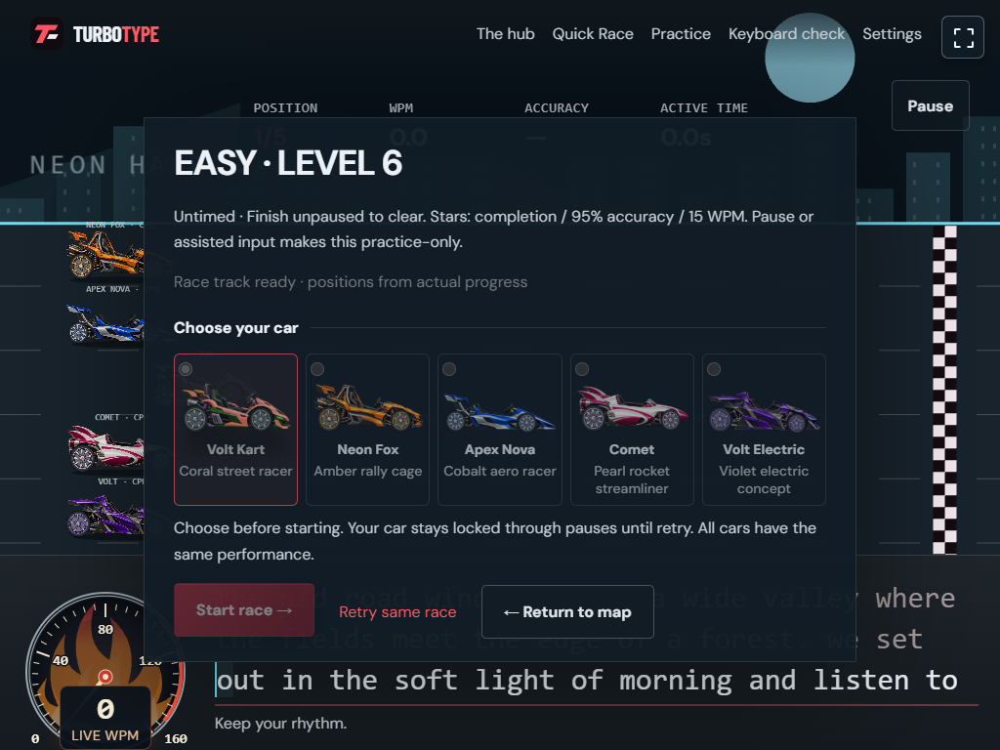

*Actual paragraph view retained in alpha.24; isolated capture fixture opens level 6. No public game is deployed. Broader atmosphere polish remains deferred.*

## Alpha.22 review refinements

The user accepted campaign unlock/save, replay counts and pause/retry eligibility. Larger typing text now top-aligns each new line with three full look-ahead rows. **Quick Race** is clearly labeled as standalone warm-up/car-track experimentation. Keyboard check covers lower/uppercase, digits/symbols and received physical keys. Opening flames follow behind the car and clear before the title; the title now stays clean without an underlay flame. [Focused review](docs/ALPHA22_REVIEW.md). Fresh local full check: **117 unit / 79 browser cases** with one worker; hosted exact-head state is separate.

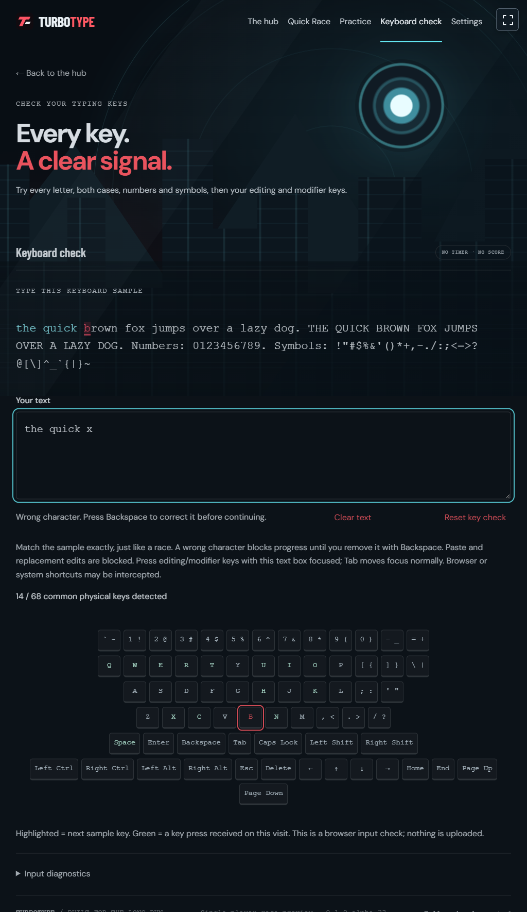

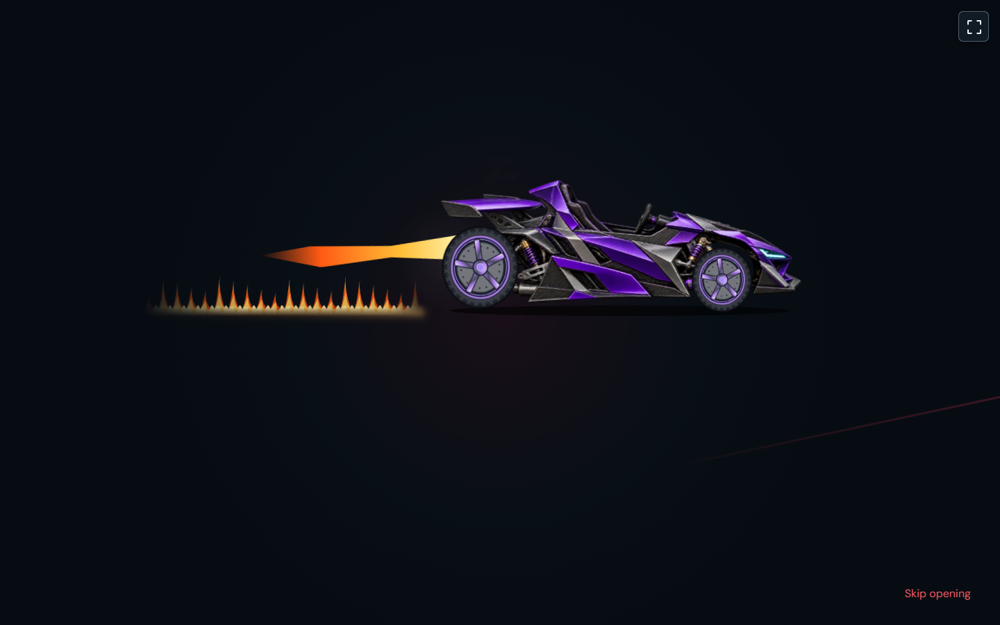

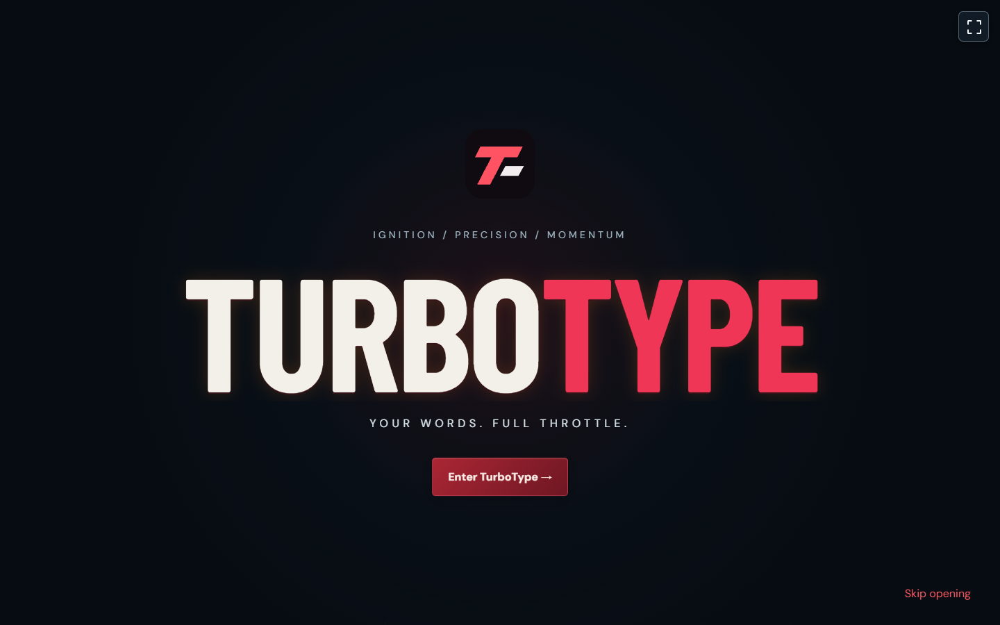

## Phase 8 — complete campaign content

**300 playable main races + 30 optional challenges.** Easy, Medium and Hard each have 100 sequential main levels across ten chapters. Only the first three races stay short. The accepted levels 4–6 remain unchanged; later passages grow toward **1,400 Easy / 2,200 Medium / 3,000 Hard characters**, with no mandatory time limit. Each chapter states its learning focus, from relaxed spacing to mixed prose and technical notation.

The original chapter anthologies supply distinct curated excerpts, deliberately revisiting familiar prose as skills build. No AI service or text download runs during gameplay. Pace/accuracy stars and CPU placement are optional: exact unpaused completion opens the next same-category race. Level 100 celebrates category completion; every cleared race remains replayable, with no level 101.

Optional side challenges unlock after chapter showcases **10/20/…/100**. Their saved checkmarks and stars remain separate from main clears/stars and cosmetic milestones. Read passage lets you inspect even a locked briefing without unlocking a race. The small map save migrates to v2 while retaining the original v1 copy; your prior clears and preferences should remain.

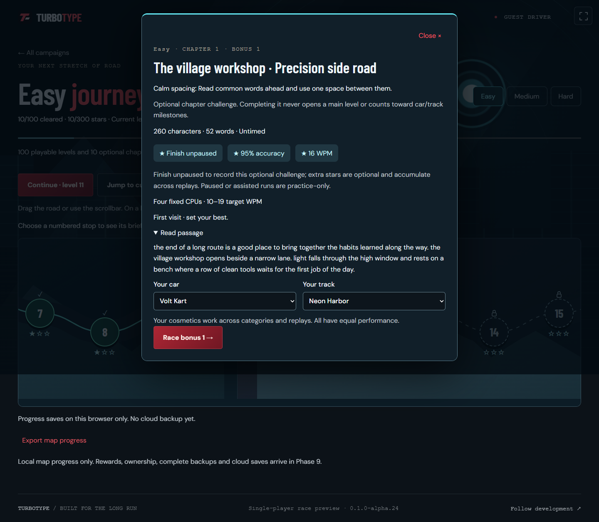

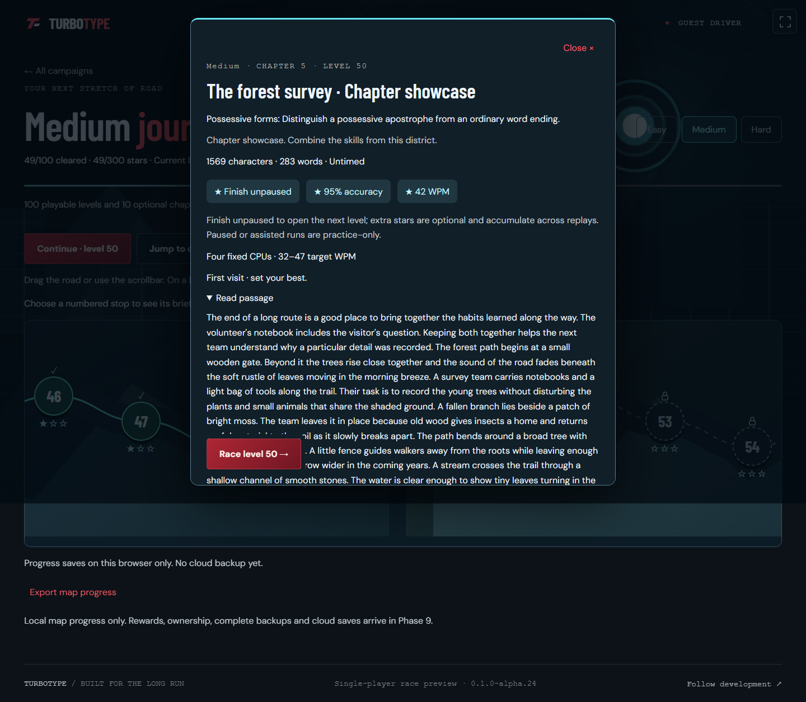

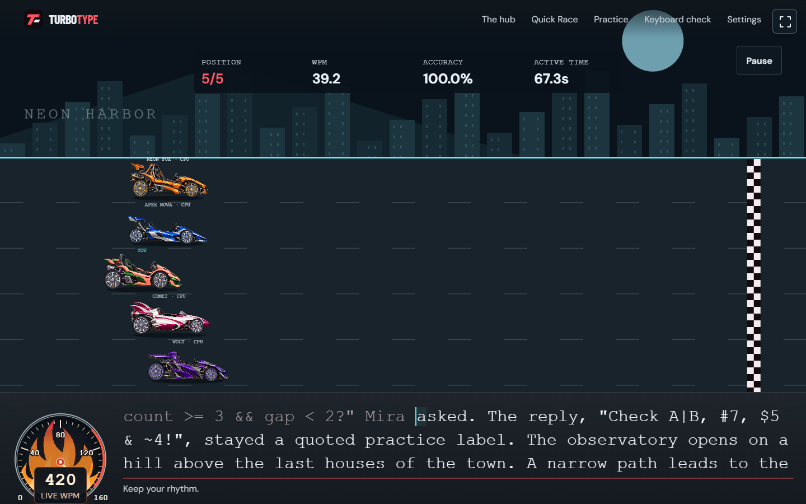

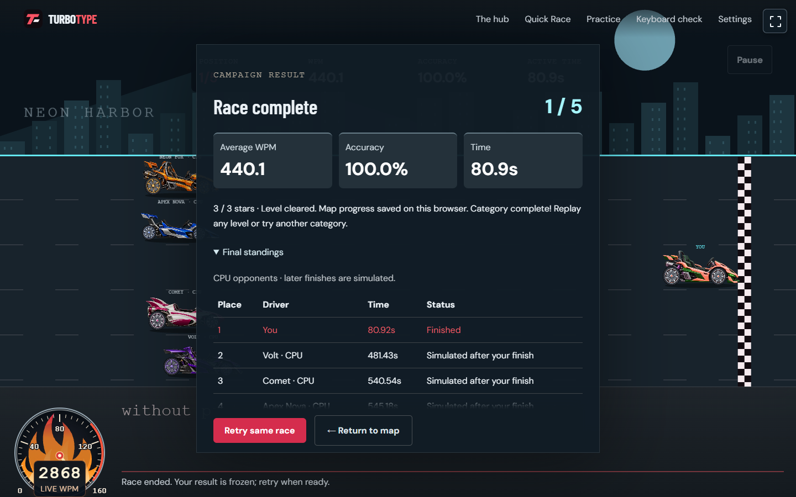

[Curriculum, content provenance and manual checklist](docs/PHASE8_CURRICULUM.md) · [Current verification](docs/TESTING.md) · [Accepted Phase 7 closeout](docs/PHASE7_CLOSEOUT.md). The current feature checkout is served at the existing LAN URL. Source pushes are not deployment; XP, credits, earned car/track ownership, canonical guest saves and optional cloud remain Phase 9.

## Phase 6 complete — alpha.20

[PR #6](https://github.com/sahilshah2904/TurboType/pull/6) implements a 5.6-second fullscreen purple-car burnout and flaming-title opening, real loading/recovery, welcome/rules, guided tutorial, optional pace calibration and returning-visitor controls. Local checks pass 102 unit / 56 browser cases. PR #6 is merged after exact-head hosted checks and the user requested completion; visual polish remains deferred as TT-608. See [Phase 6 closeout](docs/PHASE6_CLOSEOUT.md). The five starter tracks and presentation follow-up are accepted and integrated through PR #5. The alpha.14 captures below are historical race evidence.

The alpha.20 follow-up replaces rejected curved air paths with a researched layered atmosphere over sky/mountains/road, centres action links with buttons, retains the cleaner Hub/Settings, and plans varied future vehicle families. Latest captures/verification are in docs/TESTING.md. Alpha.17 opening panels are superseded.

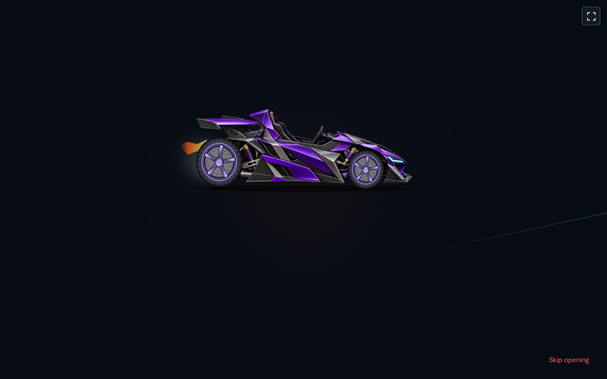


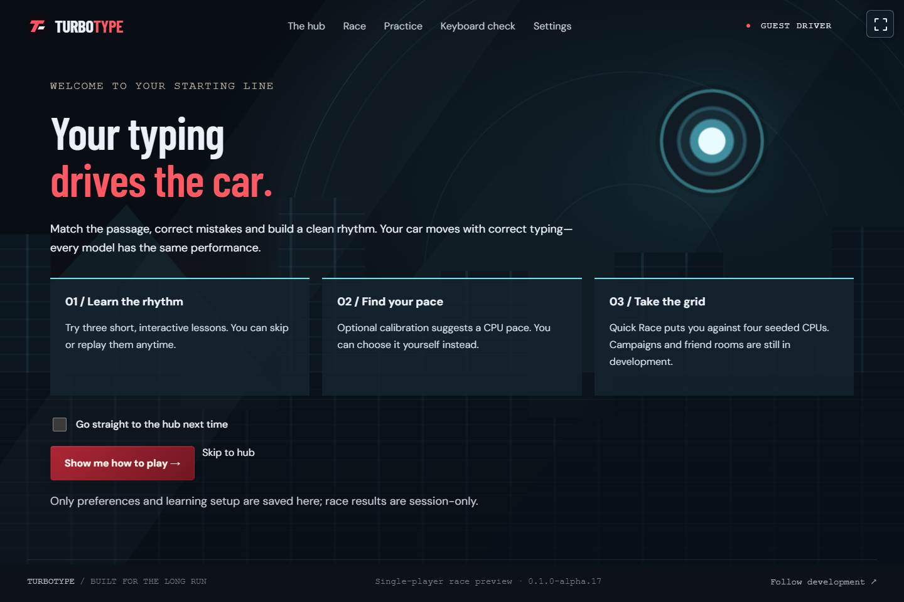

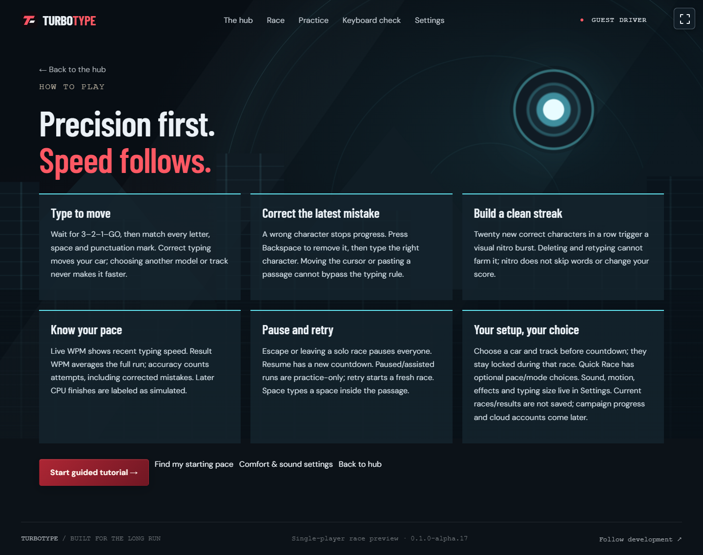

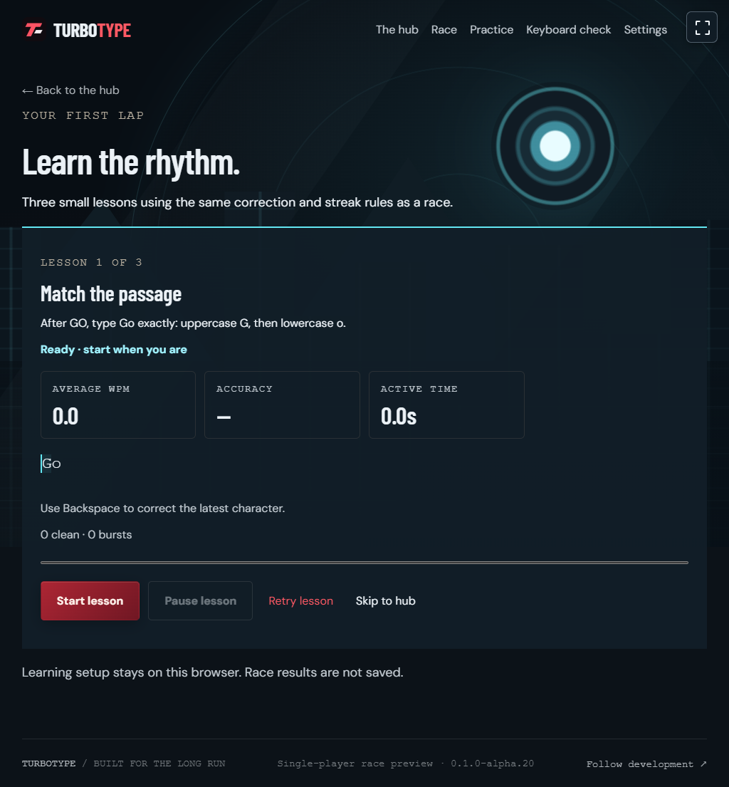

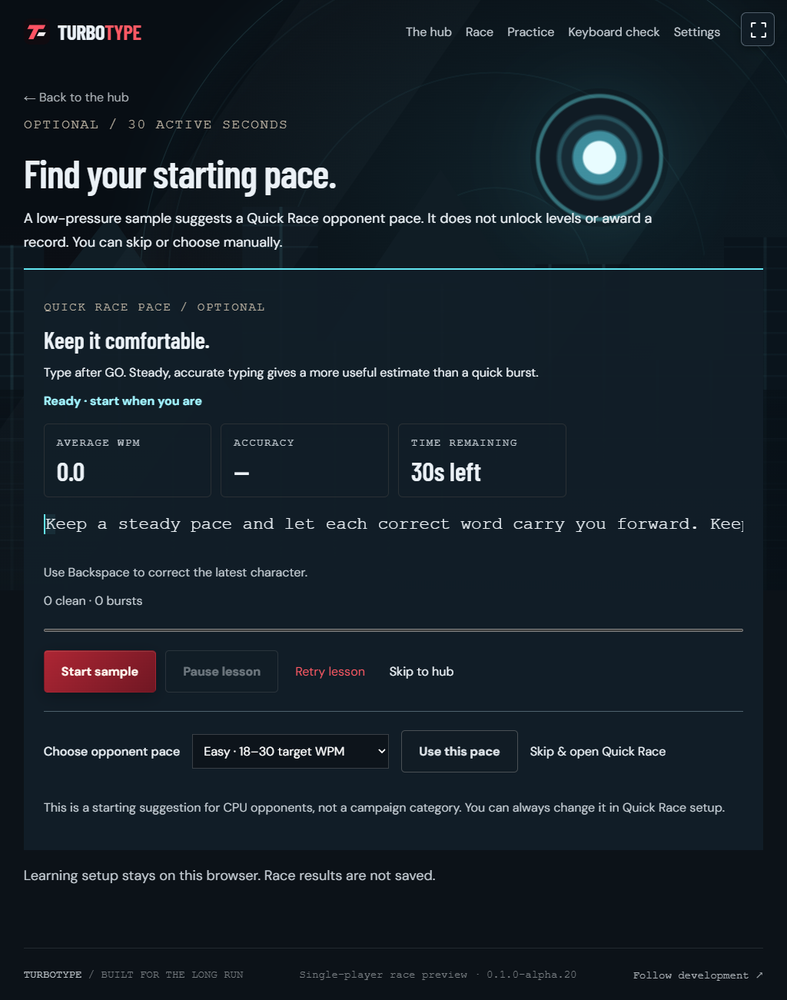

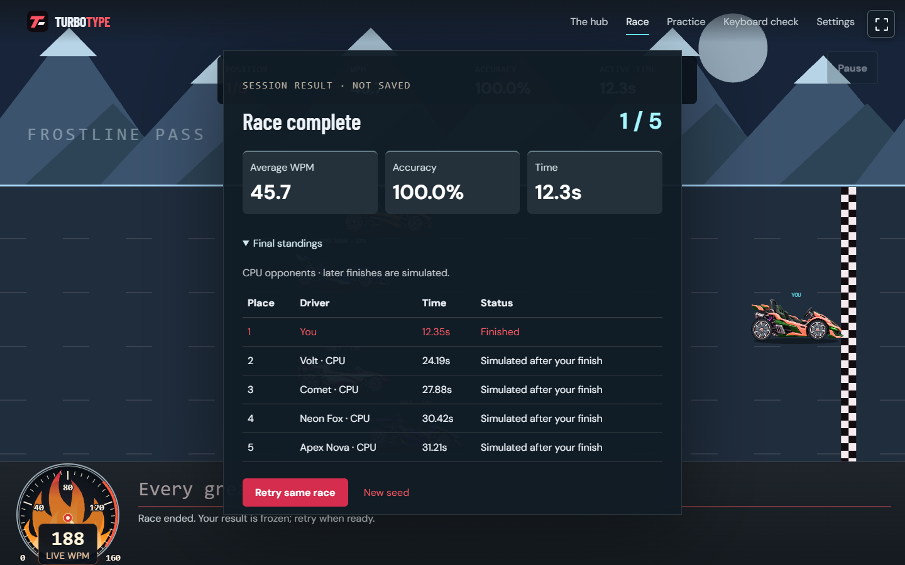

These captures show the current Phase 6 behavior; folder numbers record when each unchanged view was captured. Alpha.17 opening panels and alpha.18 wind paths are superseded. The atmosphere is retained for now, with visibility/quality improvements deferred.

[Implementation and recreation](docs/PHASE6_ONBOARDING.md) · [Laptop review checklist](docs/PHASE6_REVIEW.md) · [Current verification](docs/TESTING.md)

## What is TurboType?

TurboType turns typing practice into a side-view motor race. Correct characters move your car; mistakes require correction while four seeded computer opponents continue. It makes practice enjoyable while showing honest speed, accuracy and consistency metrics.

The current target is **laptop/desktop browsers with a physical keyboard**. Phone/tablet support was explicitly removed. Layouts adapt to laptop windows from 960 CSS pixels, with automated checks at representative 1024–1920 widths.

Single-player comes first. Three 100-level maps with sample races are available in the feature preview; full curricula, learning tools and optional cloud progress are planned before public launch, followed by friends multiplayer. **There is no public GitHub Pages game, account service or database yet.** You can run the latest preview locally.

## How the current game looks

The preview uses a full-window city circuit, detailed original karts, graphite/crimson/cyan lighting and one integrated typing surface. A shared fullscreen/restore icon sits at the upper-right of every page. Important prose/controls use 16px or larger text, with 14px compact labels.

<details>
<summary>View the current hub, car selector and Settings</summary>

### Current hub with your chosen car and campaign links

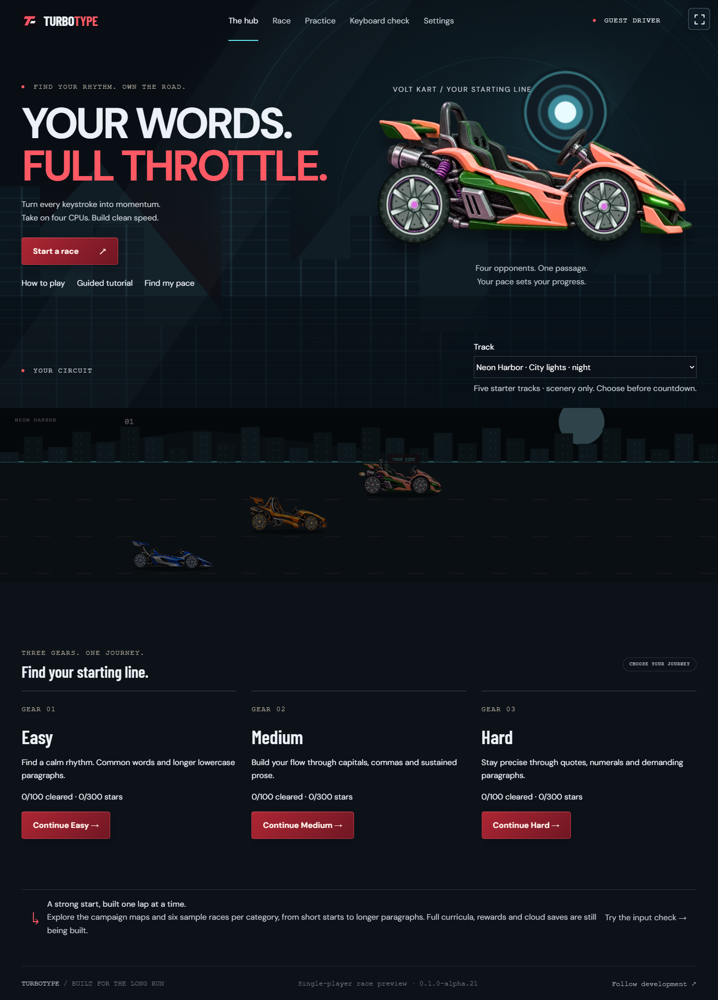

### Five starter cars before each race

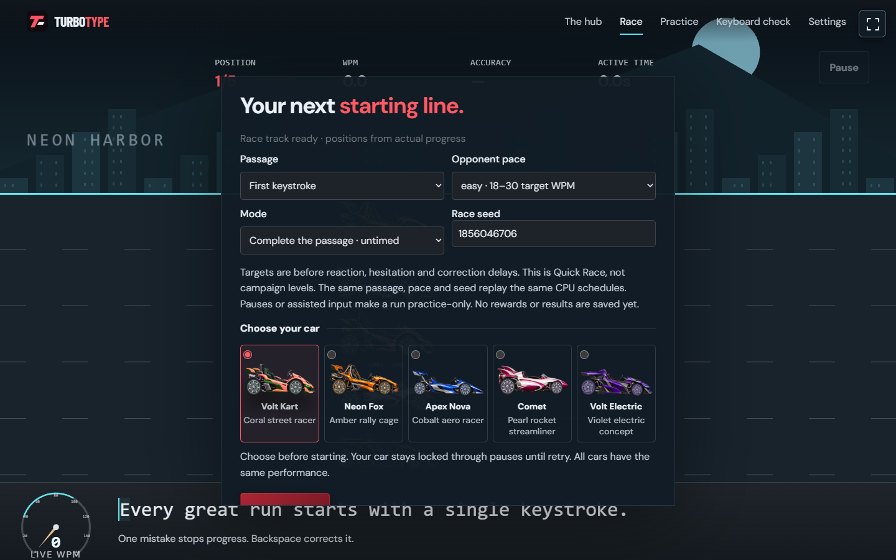

### All audio controls in Settings

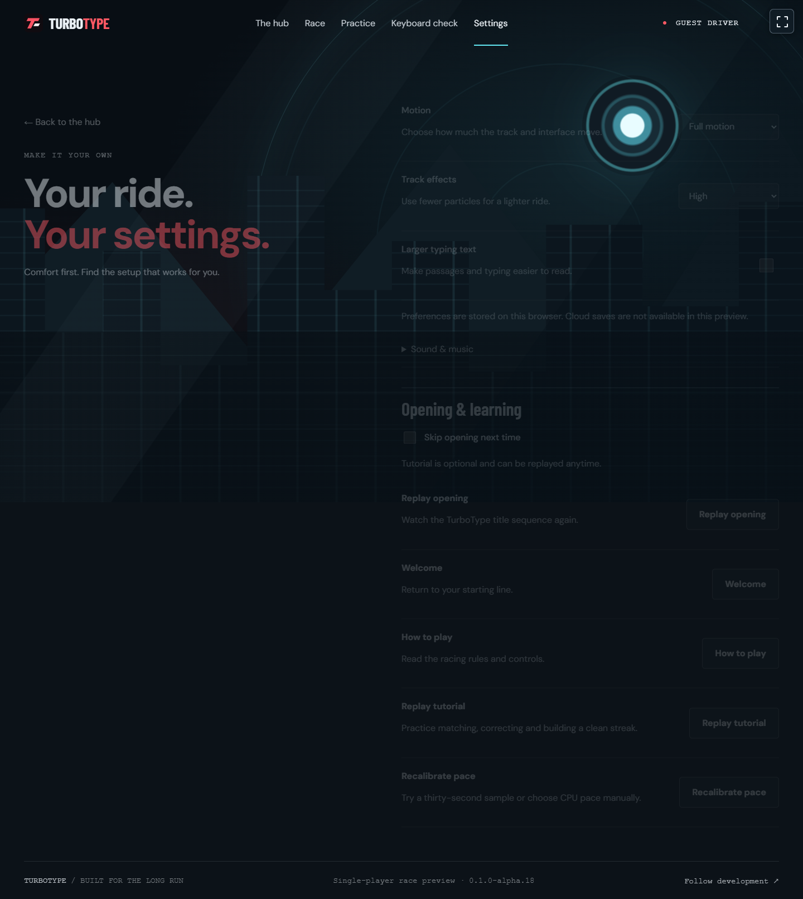

</details>

These are real app captures, not concept artwork. [Current parts/laptop captures](https://github.com/sahilshah2904/TurboType/tree/main/docs/images/alpha14) include all five starter models and 1024–1920px race layouts. Earlier screenshots remain historical evidence.

## What you can play now

| Experience | Implemented behavior |
| --- | --- |
| Campaign maps | Three 100-level journeys, all 300 passages + 30 optional challenges, local stars/clears/bests, briefings and keyboard/list/drag navigation |
| Quick Race | Four seeded CPUs, countdown, selectable passage/pace, live positions, completion or a 60-second trial, frozen results and same-seed retry |
| Car choice | Five original starters, remembered in this browser and reflected in the hub. One chosen car stays locked from countdown through the whole race, including pauses; retry/new race reopens selection |
| Typing Practice | Shared engine without opponents; WPM, accuracy, streaks, timing, correction, pause and results |
| Keyboard check | Race-style exact typing/Backspace correction, full character sample, physical-key indicators and reset |
| Racing presentation | Parallax city, exhaust flames, nitro/overtake feedback, bounded finish effects, Live WPM dial and High/Low/Reduced modes |
| Settings | Saved display/text/motion preferences and all sound enable/mute/volume controls. Original Ignition browsing music, Overdrive racing music and separate countdown/FX |
| Recovery | Graphics retry or text standings, optional audio, denied-storage notices and graceful fullscreen refusal |

**Curriculum requirement:** only the first few races use short sentences. Subsequent races must grow into substantial, coherent paragraphs for sustained typing practice, with length, punctuation and pace introduced gradually. Quick Race keeps three short validation exercises and session-only results. All campaign passages and optional challenges are authored; eligible clears, stars, bests and map positions save locally. XP/credits/reward ownership, complete guest backups, accounts/cloud and multiplayer remain future work.

## How to play

1. On **The hub**, choose **Continue Easy/Medium/Hard** for a campaign briefing, or **Race** for a standalone exercise. Choose a starter car/track before starting.
2. Press **Start race**, wait for 3–2–1/GO, then match the exact case, spaces and punctuation in the integrated strip.
3. A mistake stops your progress while CPUs continue. Use **Backspace** to correct it; accuracy retains previous attempts.
4. Use **Pause** or Escape when needed. Everyone freezes; resume has a fresh countdown. Your car cannot change mid-race. Paused runs are practice-only and cannot clear campaign levels or earn stars.
5. Finish the passage or reach the selected time limit. Results freeze; later CPU outcomes are labeled simulated. Retry resets the run and permits another car choice.

The HUD shows average WPM; the **Live WPM** dial shows recent correct typing over up to three active seconds. Nitro is a visual streak reward and never adds speed/progress. All cars have identical gameplay performance.

Open **Settings → Sound & music** to enable sound or change volumes. The hub has no audio widgets. The corner icon enters/restores fullscreen when permitted. Refresh retains preferences and saved campaign clears, but discards the current race.

[Implemented rules](https://github.com/sahilshah2904/TurboType/blob/main/docs/GAME_RULES.md) · [Race/CPU semantics](https://github.com/sahilshah2904/TurboType/blob/main/docs/QUICK_RACE.md)

## Development progress

**Phases 1–7 are complete and integrated for their agreed scope.** Alpha.14 includes independent parts, automated/actual-GPU evidence, final physical laptop acceptance and PR integration. Broader browser/long-session release testing remains Phase 10. Phase 6 alpha.20 is integrated through PR #6. Further opening/atmosphere polish is deferred. Phase 8 curriculum and optional challenges are implemented on the feature branch; final verification/user review are tracked separately.

| Phase | Delivery | Current status |
| --- | --- | --- |
| 1 | Finalize design: flow, rules, rewards, visual direction and storage/online boundaries | Baseline complete; production tuning/content remain separate |
| 2 | Set up TypeScript/Vite, Phaser/Anime.js, structure, configuration and checks | Foundation complete |
| 3 | Build validation/correction, WPM/accuracy, streaks, timing, pause and finishing | Complete for agreed engine/input scope |
| 4 | Create one complete four-CPU race with countdown, placement, results and retry | Complete and merged into main |
| 5 | Polish vehicles, wheels/suspension, scenery, exhaust/nitro, sound and celebration | Complete for agreed scope; accepted and merged into main |
| 6 | Cinematic loading/welcome/rules, tutorial, calibration and final navigation | Complete for agreed scope; PR #6 merged, TT-608 polish deferred |
| 7 | Easy/Medium/Hard rightward maps, 100 numbered nodes each, locks, chapters and saved position | Complete and accepted; PR #7 merged 04eb38d |
| 8 | All 300 passages, learning goals, difficulty/star curves and 30 bonus challenges | Implemented; verification and user review tracked separately |
| 9 | Rewards/rank/garage, records/charts/coaching/drills, robust guest saves and optional account-backed cloud progress | Planned |
| 10 | Desktop browser/accessibility/performance/recovery/cloud testing, Pages and live release verification | Planned |
| 11 | Friends backend/private rooms/invites, synchronized races, reconnect/rematches immediately after solo launch | Planned |

Phases vary greatly in size; phase numbers are not a completion percentage.

### Accepted baseline through Phase 6

- **Vehicle parts:** alpha.14 implements separate chassis/wheel sources, independent rotation, chassis-only suspension and compact shared previews while preserving the accepted silhouettes/colors. See [Phase 5 closeout](docs/PHASE5_CLOSEOUT.md).
- **Physical acceptance:** the user accepted the final laptop checklist. The two-minute recorder captured 100 trusted racing keys and zero page errors; actual-GPU experiments cover High/Low/Reduced. Timing/resource limitations and broader release checks remain explicit.
- **Integration:** PR #4 merged as de464ce after exact-head checks passed. Main includes accepted alpha.23 Phase 7 through PR #7. Phase 8 is on codex/phase8-curriculum for review; no deployment has occurred.

### Future category reward cars

Five starters are available now. Later, **each 100-level category (Easy, Medium, Hard) unlocks a distinct car every 15 eligible main-level clears**, at **15, 30, 45, 60, 75 and 90 within that category**. That is **18 reward cars plus five starters**. Category counters are independent; replay, bonus events, Quick Race and Practice do not inflate them. Cars remain cosmetic.

Stable IDs, art briefs, locked garage UX, receipt-based ownership, save recovery and cloud merges are in the [garage progression plan](https://github.com/sahilshah2904/TurboType/blob/main/docs/GARAGE_PROGRESSION.md), tracked **TT-911**. These cars/unlocks are future Phase 9 work, not a Phase 5 prerequisite.

## Run the latest preview

Use **Node.js 24.13.0**, **npm 11** and Git. Dependencies are pinned. Local solo preview needs no API key, account, database or .env file.

```powershell
git clone https://github.com/sahilshah2904/TurboType.git
cd TurboType
git switch main
npm ci
npm run dev
```

Main contains accepted Phase 7. To review Phase 8 after cloning, use `git switch codex/phase8-curriculum` before starting Vite.

Open **[http://127.0.0.1:5173/TurboType/](http://127.0.0.1:5173/TurboType/)**. Vite updates the local preview when source changes. If reusing a checkout, inspect Git status and preserve local edits before switching branches or pulling.

```powershell
npx playwright install chromium
npm run check
```

The full check runs formatting, TypeScript, unit tests, build and browser scenarios. **npm run build** creates the static artifact; **npm run preview** previews it locally. Follow the [setup guide](https://github.com/sahilshah2904/TurboType/blob/main/docs/SETUP.md) for commands/troubleshooting.

## Verification and GitHub emails

Current alpha.24 verification covers **125 unit / 116 desktop browser cases** across the broad local run and corrected focused cases, including all chapter focuses, finales, bonus clear/replay/non-inflation, legacy storage migration, four laptop widths and long-paragraph caret tracking. The full exact-head [hosted implementation check](https://github.com/sahilshah2904/TurboType/actions/runs/39888045399/job/120200909330) passed on 13b464d with all 125/116 cases and no retries. The documentation-only checkpoint has separate CI. See [current evidence](docs/TESTING.md). User review and exact-head hosted validation remain distinct.

The accepted Phase 5 baseline alpha.14 passed **96 unit tests and 36 desktop Chromium browser cases**, actual-GPU High/Low/Reduced checks and final physical laptop acceptance. The two-minute recorder captured 100 trusted racing keys with zero page errors. Exact acceptance head 398d455 passed [hosted run 39727202033](https://github.com/sahilshah2904/TurboType/actions/runs/39727202033), then PR #4 merged as de464ce. Later documentation/main heads have their own check state; the badge tracks main.

Two older runs genuinely failed when the combined garage browser test exceeded its 30-second budget while duplicate counterparts passed. The scenario is now split into focused cases without raising the timeout. Feature validation runs once per PR update, main on push, with manual dispatch and cancellation of superseded runs. Notification settings remain unchanged. [Detailed evidence/limits](https://github.com/sahilshah2904/TurboType/blob/main/docs/TESTING.md).

## Project structure

This describes the Phase 8 feature branch. Main retains accepted Phase 7 until feature review/integration.

```text
src/
  core/       Pure typing, metrics, CPU schedules, standings and campaign progress
  content/    Full campaign catalog, original prose sources, exercises and cosmetic catalogs
  game/       Phaser race/preview, kart parts/anchors and visual feedback
  ui/         Routes, native input, screens, WPM gauge and fullscreen
  audio/      Optional music/effects ownership and lifecycle
  storage/    Validated preferences/onboarding and basic local campaign progress
  config/     App, rules, save and content versions
public/assets/ Authored game art, audio and provenance-backed assets
assets-source/ Raster masters/prompts and reproducible authoring scripts
scripts/       Kart exports and isolated/full-app profiling tools
tests/browser/ End-to-end input, race, settings, graphics and recovery
docs/          Design, architecture, recreation, screenshots and handoff
Reference_Images/ Ignored user recordings/screenshots/analysis tools
```

Phaser owns the canvas; native HTML owns input/navigation; Anime.js coordinates brief interface motion. Pure rules do not depend on frame rate, sound or selected car. GitHub Actions validates source; **it does not deploy the game**.

## Saves, hosting and future multiplayer

Only display/audio/car preferences persist locally today. A future guest save model will store campaign clears, rewards and ownership with migration/recovery; optional account-backed cloud progress comes before public solo launch. A selected-car preference will not be trusted as ownership.

GitHub Pages will host the frontend. Friends rooms need external auth/data/realtime services for invites, ready checks, synchronized races and reconnection. Sharing a static URL alone does not create multiplayer. Provider choice and infrastructure are pending.

## Continue in a new project chat

Start with [AGENTS.md](https://github.com/sahilshah2904/TurboType/blob/main/AGENTS.md), the [detailed session handoff](https://github.com/sahilshah2904/TurboType/blob/main/docs/SESSION_HANDOFF.md), [project status](https://github.com/sahilshah2904/TurboType/blob/main/PROJECT_STATUS.md) and [stable backlog](https://github.com/sahilshah2904/TurboType/blob/main/BACKLOG.md). They record accepted decisions, current code/CI, completed work, pending tasks and the next steps. The previous chat is not required.

## Documentation

These links deliberately target the preview branch so the default-branch README points to current evidence.

| Purpose | Guide |
| --- | --- |
| Product and designed rule/reward/storage defaults | [Game plan](https://github.com/sahilshah2904/TurboType/blob/main/GAME_DESIGN_PLAN.md) · [Baseline](https://github.com/sahilshah2904/TurboType/blob/main/docs/RULES_AND_STORAGE_BASELINE.md) |
| Implemented behavior | [Rules](https://github.com/sahilshah2904/TurboType/blob/main/docs/GAME_RULES.md) · [Quick Race](https://github.com/sahilshah2904/TurboType/blob/main/docs/QUICK_RACE.md) |
| Architecture and conventions | [Architecture](https://github.com/sahilshah2904/TurboType/blob/main/docs/ARCHITECTURE.md) · [Engineering](https://github.com/sahilshah2904/TurboType/blob/main/docs/ENGINEERING_CONVENTIONS.md) · [GitHub workflow](https://github.com/sahilshah2904/TurboType/blob/main/docs/GITHUB_WORKFLOW.md) |
| Recreate the assets and app | [Fleet](https://github.com/sahilshah2904/TurboType/blob/main/docs/KART_FLEET.md) · [Audio](https://github.com/sahilshah2904/TurboType/blob/main/docs/AUDIO.md) · [Visual integration](https://github.com/sahilshah2904/TurboType/blob/main/docs/IMMERSIVE_APP.md) |
| Testing and measured limits | [Verification](https://github.com/sahilshah2904/TurboType/blob/main/docs/TESTING.md) · [Full-app profile](https://github.com/sahilshah2904/TurboType/blob/main/docs/PERFORMANCE_ALPHA14.md) |

Original assets/audio have tracked sources/prompts/provenance. Reel assets/music and franchise artwork are not shipped. This is a development preview, not a completed single-player release.
