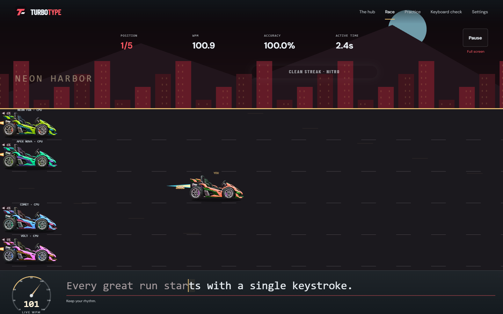

<div align="center">

# TurboType

### Build your rhythm. Find your speed. Race the road ahead.

A browser-based typing racer where every correct character moves your car forward.
Race four computer opponents while improving physical-keyboard speed, accuracy and clean corrections on your laptop.

[](https://github.com/sahilshah2904/TurboType/actions/workflows/checks.yml)

[Get started](#get-started) · [How to play](#how-to-play) · [Project structure](#project-structure) · [Roadmap](#roadmap) · [Documentation](#documentation)

</div>



*Actual alpha.9 metallic red/gold development preview from `feat/race-polish`. The integrated full-window kart design is awaiting device acceptance in [PR #4](https://github.com/sahilshah2904/TurboType/pull/4).*

## Current focus — laptop typing

TurboType now targets **laptop/desktop browsers and physical keyboards only**. Phone/tablet support was explicitly removed from the scope. Layouts adapt to laptop window sizes (960 CSS px minimum), with checks at 1024–1920 widths. Mobile keyboard/rotation handling and phone/tablet test profiles are removed. Cloud progress and friends multiplayer remain planned. Earlier mobile test reports below are historical.

Current preview **0.1.0-alpha.9** emphasizes metallic red and gold, with cyan limited to small light details. **Ignition**, a brighter 124 BPM major-key browsing track, replaces Nightforge. The user-approved **Overdrive** racing track is unchanged.

## What is TurboType?

TurboType turns typing practice into a side-view motor race. Your car advances as you type a passage correctly, while four computer opponents compete at a selected pace. Make a mistake, correct it with Backspace, and build your rhythm again. The goal is to make practice enjoyable while giving clear feedback on speed, accuracy and consistency.

The project is being built in documented stages: a responsive single-player game first, followed by campaign progression, optional cloud saves and friends multiplayer. Original vehicles, scenery and synthesized music give the game its own identity.

> **Development status:** `main` contains the accepted Phase 4 playable race. The latest Phase 5/6 visual integration is on `feat/race-polish`: the approved full-window kart race, one visible typing surface, Live WPM dial and revamped existing pages are implemented with the current metallic red/gold palette and separate original browsing/racing soundtracks. Current checks are recorded in [verification evidence](docs/TESTING.md); actual-device acceptance remains open; the distinct fleet and cinematic onboarding are still pending. There is **no public GitHub Pages game link yet**. You can run either version locally.

## What you can play today

| Experience | What it offers |
| --- | --- |
| **Quick Race** | Four seeded CPU opponents, selectable pace, countdown, live standings, passage completion or a 60-second time trial, and frozen results. |
| **Typing Practice** | The same typing engine without opponents, with WPM, accuracy, active time and clean-streak feedback. |
| **Keyboard Check** | A free-editing screen for checking your physical keyboard before racing. |
| **Preferences** | Saved motion, effects, text size and audio volumes; separate original menu/race music. |
| **Integrated kart preview** | Edge-to-edge Phaser racing, one visible typing strip, recent-WPM speedometer, moving exhaust, bounded effects, and original optional music. Existing hub, practice, keyboard and settings pages share the new open world layout. The distinct vehicle fleet remains in development. |

The current passages are short exercises for validating the game. Campaign levels, stars, rewards, a garage, accounts, cloud progress and multiplayer are planned features. Campaign cards in the hub are previews.

Open **Sound & music** to enable the original soundtrack: **Ignition** while browsing and **Overdrive** while racing, with a separate 3–2–1 start score. There is no personal-music chooser. [Audio details and recreation](docs/AUDIO.md).

## Progress checkpoint and next session

Current preview is **0.1.0-alpha.9** on **feat/race-polish**, in open [PR #4](https://github.com/sahilshah2904/TurboType/pull/4). **Phases 1–4 are complete for their agreed scope; Phase 5 remains in progress.** Existing-page Phase 6 visuals are implemented, but onboarding is not. No Pages game, backend or database is deployed.

Delivered: planning/rules and repository foundation; strict typing engine; four seeded CPU races; countdown, WPM/accuracy/streaks, pause/results/retry/recovery; full-window kart racing and one visible typing surface; live speedometer, exhaust/nitro/parallax/finish effects; full-width hub preview; revamped existing pages; independent original browsing/racing music and countdown; saved preferences and reproducible checks/docs.

Latest user feedback: racing music and checks 5/6 (typing/speedometer/mistakes/correction and pause/resume/retry) work. **Overdrive is unchanged.** Ignition replaces the rejected sad menu track; metallic red/gold replaces the cyan-heavy palette. Phone/tablet compatibility was explicitly canceled. Hardware IME input and accessibility remain supported; the reported phone word-at-a-time caret issue is out of scope, not fixed.

Validation: local formatting/types/build, **87 unit cases and 26 desktop Chromium browser cases pass**. Phone/tablet profiles were removed, so the former 78 executions (26 × 3) are historical. Current laptop screenshots are in [docs/images/alpha9](docs/images/alpha9); [test evidence](docs/TESTING.md) distinguishes each source and hosted CI. Earlier ASUS/Samsung reports do not imply current mobile support.

| Next phase | Pending work |
| --- | --- |
| **5** | Laptop review of new red/gold colors and Ignition; distinct vehicle bodies/wheels; real laptop loop/mix/interruptions and performance/decode/transfer/memory measurements; final PR integration after acceptance. TT-505/506/508–513/515/518–520. |
| **6** | Cinematic opening/loading, rules/welcome/tutorial/calibration and final laptop flow. |
| **7–8** | Three rightward 100-node maps with locks/chapters/bonuses; author, validate and balance all 300 levels. |
| **9** | Rewards/rank/garage/records/coaching, robust guest saves and optional account-backed cloud progress before public solo launch. |
| **10** | Desktop browser/keyboard/accessibility/performance/cloud verification, Pages setup and actual public-link release checks. Phone/tablet coverage is retired. |
| **11** | Friends backend, private rooms/invites, synchronized races/reconnects/rematches immediately after solo launch. |

Resume from [AGENTS.md](AGENTS.md), [PROJECT_STATUS.md](PROJECT_STATUS.md), [BACKLOG.md](BACKLOG.md) and the [laptop checklist](docs/PHASE5_POLISH_TESTS.md). Complete current Phase 5 gates before moving on. The [eleven-phase roadmap](#roadmap) below retains its numbering; phase counts are not a completion percentage.

## Get started

### 1. Install the prerequisites

Use **Node.js 24.13.0**, **npm 11** and Git. The exact Node version is recorded in [.nvmrc](.nvmrc), and the dependency graph is pinned in [package-lock.json](package-lock.json). A fresh local preview needs no account, API key, database or `.env` file.

### 2. Clone and run the latest preview

```powershell
git clone https://github.com/sahilshah2904/TurboType.git
cd TurboType
git switch feat/race-polish
npm ci
npm run dev
```

Open **[http://127.0.0.1:5173/TurboType/](http://127.0.0.1:5173/TurboType/)** and choose **Race**. Vite watches source changes while the development server runs. Press **Ctrl+C** to stop it.

To use the accepted Phase 4 baseline, stay on `main` instead of switching to the preview branch. Once Phase 5 merges, `main` will include the polished experience.

For laptop setup details and troubleshooting, read the [setup guide](docs/SETUP.md).

## How to play

1. Choose a passage, opponent pace and race mode. A seed lets you replay the same computer-opponent schedules.
2. Select **Start race** and wait for the three-second countdown. Typing counts after **GO**.
3. Match the passage's letters, capitalization, spaces and punctuation. Correct characters move your car.
4. If you make a mistake, your progress stops while the CPUs continue. **Backspace** removes the wrong character so you can correct it. Earlier errors still count toward accuracy.
5. Complete the passage, or reach the time limit, to see your result. **Retry same race** resets the run with the same opponents; **New seed** changes their schedules.

| Control or setting | Behavior |
| --- | --- |
| **Pause / Esc** | Freezes the player and CPUs. Resume starts a fresh countdown. Leaving the race or switching browser tabs also pauses it. |
| **Sound & music** | Phase 5: select **Enable sound** to start optional audio. Master, music and effects volumes are separate; sound starts muted. |
| **Reduced motion** | Keeps essential progress visible with a stable full-course view and fewer decorative movements. |
| **Larger typing text** | Makes text easier to read; Phase 5 also wraps the passage instead of using the scrolling strip. |

**Understanding your result:** WPM uses five characters per word and active racing time. Accuracy measures correct attempts out of all character attempts; corrections do not erase mistakes. Clean streaks reward consecutive new correct characters with visual nitro, which does not artificially advance your car. Paused or detectably assisted runs are marked practice-only. Results are currently session-only; refreshing ends the run.

The [typing rules](docs/GAME_RULES.md) and [Quick Race guide](docs/QUICK_RACE.md) explain timing, correction, CPU schedules, ties and timeouts in detail.

## Built with

| Technology | Responsibility |
| --- | --- |
| **TypeScript** | Strict types, pure typing/race rules and application code. |
| **Vite** | Local development and static production builds. |
| **Phaser** | Track rendering, vehicles, camera and racing effects. |
| **Anime.js** | Interface entrances and short animated feedback. |
| **Web Audio API** | Phase 5 original synthesized music and sound effects, using original bundled audio. |
| **Vitest + Playwright** | Unit tests and browser checks across the desktop Chromium profile at laptop window sizes. |
| **GitHub Actions** | Installation, formatting, type checks, tests and production-build verification. |

The [immersive integration guide](docs/IMMERSIVE_APP.md) explains the new page layouts, native typing strip, live speedometer and renderer limitations.

The application uses HTML/CSS for readable controls and typing input, with a separate canvas for the race. Rendering and sound read game state; they do not determine typing accuracy, CPU outcomes or rewards. See the [architecture guide](docs/ARCHITECTURE.md) for ownership and cleanup boundaries.

## Project structure

The latest development preview is organized as follows. Campaign and backend folders will be added when those systems are implemented.

```text
TurboType/
├── src/
│   ├── core/            # Pure typing engine, seeded CPUs, race state and standings
│   ├── content/         # Original practice passages
│   ├── game/            # Phaser scenes, camera projection and visual feedback
│   ├── ui/              # Screens, routing, input adapter and audio controls
│   ├── audio/           # Original score, synthesis and sound lifecycle (Phase 5)
│   ├── storage/         # Validated browser-local preferences
│   ├── config/          # App, rules, save and content versions
│   ├── main.ts          # Application entry point
│   └── styles.css       # Responsive layout and visual styling
├── public/assets/       # Shipped artwork and asset notices
├── assets-source/       # Reproducible vehicle authoring scripts (Phase 5)
├── scripts/             # Isolated renderer profiling tools (Phase 5)
├── tests/browser/       # Playwright integration and layout checks
├── docs/                # Setup, rules, architecture, evidence and decisions
│   ├── adr/             # Architecture decision records
│   └── images/          # Actual application screenshots
├── .github/workflows/   # Checks-only continuous integration
├── PROJECT_STATUS.md    # Current phase, completed work and outstanding gates
├── BACKLOG.md           # Stable task IDs and future/deferred work
└── GAME_DESIGN_PLAN.md  # Product vision, planned rules and delivery plan
```

Focused unit tests live beside their source modules as `*.test.ts`; browser flows use `*.spec.ts`. Generated output such as `dist/`, dependencies and local reference recordings are excluded from Git.

## Development and verification

Install Playwright's Chromium browser once, then run the complete check:

```powershell
npx playwright install chromium
npm run check
```

| Command | Purpose |
| --- | --- |
| `npm run dev` | Start the development server on port 5173. |
| `npm run build` | Check TypeScript and build static files into `dist/`. |
| `npm run preview` | Serve the built artifact on port 4173 under `/TurboType/`. |
| `npm test` | Run unit tests. |
| `npm run test:browser` | Run browser checks against the built artifact; run `npm run build` first. |
| `npm run typecheck` | Check types without emitting files. |
| `npm run format` | Format source, tests and configuration. |
| `npm run check` | Run formatting checks, types, unit tests, build and browser tests. |

**Current alpha.9 verification:** local formatting/types/build, **87 unit cases and 26 desktop browser cases passed**. Hosted CI has its own status in the checkpoint above. Real ASUS/Samsung listening/native-keyboard/smoothness and broader physical-device evidence remain open; see [verification evidence](docs/TESTING.md) and the [device checklist](docs/PHASE5_POLISH_TESTS.md).

Recreate the shipped audio with `node assets-source/build-soundtracks.mjs`. The earlier `build-vehicles.mjs` recreates legacy SVGs; current racing uses one original kart PNG with runtime palettes. See [asset provenance](docs/ASSETS.md), [audio source and lifecycle](docs/AUDIO.md) and [current implementation](docs/IMMERSIVE_APP.md). Older renderer profiles remain historical and do not certify alpha.8 on physical devices.

## Roadmap

TurboType follows eleven phases, with single-player first and friends multiplayer immediately after its public launch. **Current position: the approved Phase 5 kart design is integrated in alpha.5; existing-page visual work from Phase 6 is also implemented. Final verification and device acceptance remain open.** Completed phases describe their agreed scope, not certification on every device.

### 1. Finalize the design

**Status: Design baseline complete.**

Confirm the screen flow, typing rules, progression, visual style and rewards. The plan covers responsive single-player first and multiplayer later. Production content and balance will continue to be refined through playtesting.

### 2. Set up the application

**Status: Foundation complete, with documented device-coverage exceptions.**

Create the TypeScript/Vite project, integrate Phaser and Anime.js, and establish the folder structure, configuration, version control and automated checks. Define storage, account and network boundaries early so later features fit the same architecture.

### 3. Build the typing engine

**Status: Complete for the agreed scope.**

Implement character validation, Backspace correction, accuracy, WPM, streaks, timing, pauses and finishing. Test these rules independently of animation, then verify input behavior on available laptop hardware.

### 4. Create one complete playable race

**Status: Complete for the agreed scope; merged into `main`.**

Add four computer opponents, countdown, vehicle movement, passage display, placement, results and retry. This proves the core game works before expanding it. Keep race metrics above the course and the passage/input below it.

### 5. Polish the racing experience

**Status: Approved visual direction integrated on `feat/race-polish`; final device acceptance and distinct fleet pending.**

Add detailed vehicles, rotating wheels, suspension, parallax scenery, exhaust, nitro, overtaking effects, sound and finish celebrations. Provide low-effects and reduced-motion options. The rejected boxed layout has been replaced in the development branch by a full-viewport kart race, integrated typing and Live WPM speedometer. See the [implementation guide](docs/IMMERSIVE_APP.md). ASUS/Samsung visual, audible-balance and real-device smoothness checks remain open in [PR #4](https://github.com/sahilshah2904/TurboType/pull/4).

### 6. Build the opening and onboarding

**Status: Existing hub/practice/keyboard/settings visually revamped; new opening/onboarding flows not started.**

Create the cinematic loading sequence, welcome screen, rules, interactive tutorial, optional calibration and animated main hub. Support both first-time and returning players.

### 7. Build the campaign maps

**Status: Planned; not started.**

Create separate Easy, Medium and Hard maps with 100 numbered levels each, rightward scrolling, circular locked nodes, chapter markers and saved progress. Unlock the next stage as the player clears each level.

### 8. Develop all 300 levels

**Status: Planned; not started.**

Author and validate passages, learning objectives, CPU difficulty, star targets and gradual difficulty increases. Add chapter showcases and optional bonus challenges alongside the 300 main levels.

### 9. Add progression and learning tools

**Status: Planned; not started.**

Implement cosmetic rewards, Driver Rank, garage customization, personal records, progress charts, coaching and targeted practice drills. Add guest saves and optional account-backed cloud progress, including synchronization, migrations and recovery, before the public single-player launch.

### 10. Test and launch single-player

**Status: Planned; not started.**

Check performance, accessibility, browser compatibility, saves, recovery and repeated retries across supported laptops/desktops. Verify cloud synchronization and data access controls. Configure GitHub Pages and test the live game before calling it launched.

### 11. Add friends multiplayer later

**Status: Planned immediately after single-player launch.**

Reuse the account/database foundation and introduce a realtime race backend, private rooms, invitation links, ready checks, synchronized races, reconnection handling and rematches. The frontend stays on GitHub Pages.

[Project status](https://github.com/sahilshah2904/TurboType/blob/feat/race-polish/PROJECT_STATUS.md) records phase evidence and acceptance gates. The [backlog](https://github.com/sahilshah2904/TurboType/blob/feat/race-polish/BACKLOG.md) preserves detailed task IDs and deferred work. These phases vary in size; the phase number is not an overall completion percentage.

## Saves, hosting and multiplayer

Today, browser storage remembers preferences. Race text/results live only in memory; there is no account, database, saved campaign progress or multiplayer service yet.

GitHub Pages is the planned host for the static game. A separate backend will provide optional account-backed progress and later realtime multiplayer. The [responsive and online architecture](docs/RESPONSIVE_AND_ONLINE_ARCHITECTURE.md) records those boundaries; a provider project has not been provisioned.

Saving a local file updates your development preview. **Commit and push** publish source changes to GitHub. A future Pages deployment workflow will publish the playable website separately; the current workflow only checks the project.

## Documentation

| Start here if you want to… | Read |
| --- | --- |
| Set up, build or troubleshoot the project | [Setup guide](docs/SETUP.md) |
| Understand implemented gameplay and correction | [Game rules](docs/GAME_RULES.md) · [Quick Race](docs/QUICK_RACE.md) |
| Navigate the code and its boundaries | [Architecture](docs/ARCHITECTURE.md) · [Decision records](docs/adr) |
| Understand the art, sound and performance direction | [Art bible](https://github.com/sahilshah2904/TurboType/blob/feat/race-polish/docs/ART_BIBLE.md) · [Audio](https://github.com/sahilshah2904/TurboType/blob/feat/race-polish/docs/AUDIO.md) · [Performance](https://github.com/sahilshah2904/TurboType/blob/feat/race-polish/docs/PERFORMANCE.md) |
| Follow the product plan and future work | [Game design](GAME_DESIGN_PLAN.md) · [Latest status](https://github.com/sahilshah2904/TurboType/blob/feat/race-polish/PROJECT_STATUS.md) · [Backlog](https://github.com/sahilshah2904/TurboType/blob/feat/race-polish/BACKLOG.md) |
| Reproduce checks or understand coverage limits | [Latest test evidence](https://github.com/sahilshah2904/TurboType/blob/feat/race-polish/docs/TESTING.md) |
| Follow naming, versioning and Git practices | [Engineering conventions](docs/ENGINEERING_CONVENTIONS.md) · [GitHub workflow](docs/GITHUB_WORKFLOW.md) |
| Review research and future data rules | [Implementation research](IMPLEMENTATION_RESEARCH.md) · [Rules/storage baseline](docs/RULES_AND_STORAGE_BASELINE.md) |

## Feedback and contributions

Found a bug or have an idea? [Open an issue](https://github.com/sahilshah2904/TurboType/issues). Include the branch/version, device, browser, steps to reproduce, and what you expected. Screenshots help with layout; a short recording helps with motion or sound problems.

For code changes, follow the engineering conventions, use a focused branch, update the relevant documentation and run the checks before opening a pull request. Keep future proposals distinct from implemented behavior. Use short, meaningful plain-English commit messages.

Created by **Sahilshah**. Vehicle artwork and synthesized music in the Phase 5 preview are original project assets; fonts retain their license notices. User reference recordings and their soundtrack are not shipped. A project-wide license has not yet been selected.
